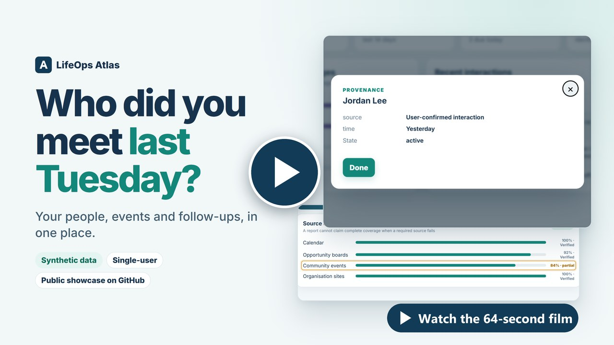
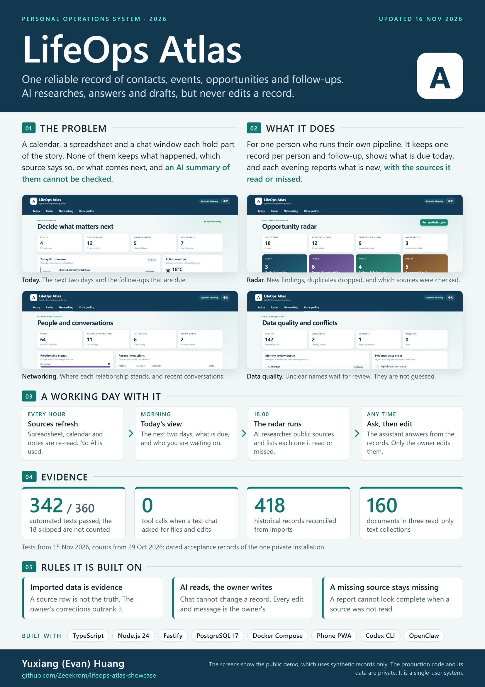
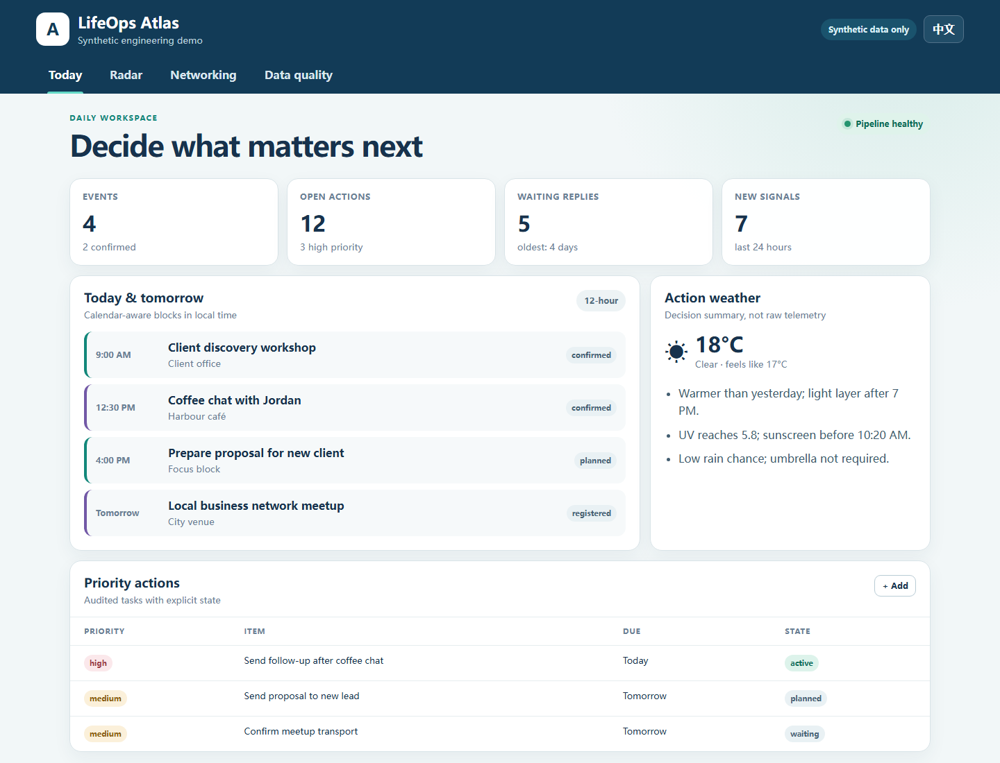
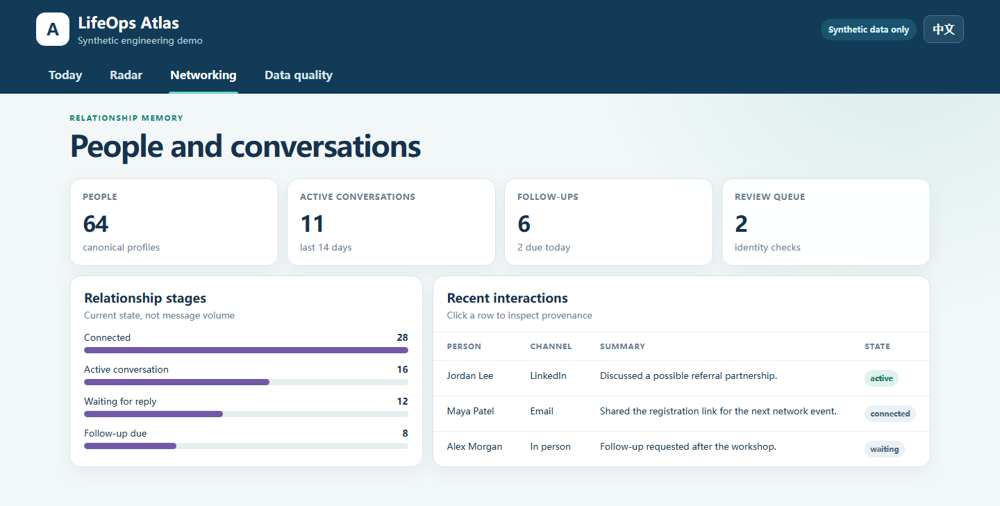
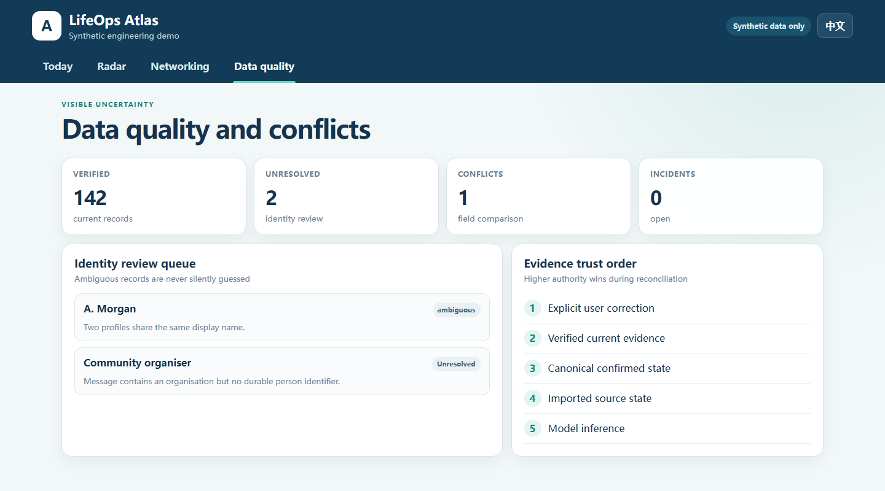

# LifeOps Atlas

<strong>English</strong> · <a href="README.zh-CN.md">简体中文</a>

A personal operations system: one checked record of contacts, follow-ups and opportunities; AI drafts, code decides, the owner sends.

<table>
<tr>
<td align="center" width="50%"> <b>Short film</b> · 1:04</td>
<td align="center" width="50%"> <b>Poster</b></td>
</tr>
<tr>
<td align="center" width="50%"> <b>Code walkthrough</b> · 1:28</td>
<td align="center" width="50%"> <b>Replay</b> · open to all</td>
</tr>
</table>

**What you can check**

- **The model rewrites one paragraph; code decides the rest.** It may change only the resume's Summary. A word limit, a fact check against the resume and a byte-level guard on the Word file decide whether the draft is used, and four of the file's five parts stay byte-identical. → [walkthrough](https://lifeops.evanh.dev/walkthrough/) · [replay, step 7](https://lifeops.evanh.dev/?run=run-1&step=7)
- **Sensitive answers stay with a person.** On an offline form, work rights, pay and the consent box are left for the owner whatever the model says, and submitting is blocked: zero submissions in both runs. → [replay, step 12](https://lifeops.evanh.dev/?run=run-1&step=12)
- **Real model calls, restricted and receipted.** Each run makes two calls to gpt-5.6-sol through the official Codex CLI, with tools, network and web search off and a JSON schema on the reply; token counts are the CLI's own receipts. → [replay, step 4](https://lifeops.evanh.dev/?run=run-1&step=4)
- **The screens, with made-up records.** Today, Radar, Networking and Data quality run in the browser on sample data with preset responses: no backend, no account, no AI call. → [synthetic demo](https://zeeekrom.github.io/lifeops-atlas-showcase/)

Showcase only: synthetic data, source private. Source code and a code walk-through are available on request: [message me on LinkedIn](https://www.linkedin.com/in/evan-h-165976301/) or email [yuxianghuang2026@gmail.com](mailto:yuxianghuang2026@gmail.com). → [Public versus private](#public-versus-private) · [Copyright and terms](#copyright-and-terms)

## The problem

A calendar, a spreadsheet and a chat window each hold part of the story. Running your own pipeline of contacts, events, opportunities and applications means answering the same questions every day:

- What is due today, and who am I waiting on?
- When did I last talk to this person, and what did I say I would do?
- Did the latest import just undo something I corrected by hand?
- Is this evening's research complete, or did some sources fail?
- Can an AI answer from my records without being able to change them?

LifeOps Atlas answers them from one database and keeps the source of each fact beside it.

## Who it is for

One person running their own pipeline: someone looking for work, building a network in a new city, or working independently. The working installation serves its owner; use by a small team is a possible direction, not something built or tested.

## One follow-up, start to finish

The example is illustrative and contains no private contact or message.

1. **Something real happens.** The owner records an email they sent and links it to a person and an Action.
2. **A checkpoint is set.** An email follow-up waits seven days by default; each channel has its own rule.
3. **Sources refresh.** Once an hour the permitted sources are re-read and reconciled. No AI model is called.
4. **AI work runs as a saved job.** The job is saved before any model call. A research run records which sources it read; an answer uses only the records it was given.
5. **The result is checked and kept** with its evidence. A saved report and a delivered notification are separate states.
6. **The owner decides.** Chat returns an explanation or a draft; the owner edits the Action and sends any message or application themselves.

## How it is kept honest

- **AI reads and drafts; it never changes a record.** Chat is read-only, edits go through checked forms, and every message and application is sent by the owner.
- **A correction survives the next import.** Imported rows are evidence, not truth; the owner's corrections are stored apart and win.
- **A failure leaves a request, not lost work.** The job is saved before the model is called; a failed call is classified and reported, never silently switched to another provider.
- **A missing source stays missing.** A report cannot claim complete coverage when a required source failed.
- **Real data is kept local.** Real records are stored on the owner's own computer, not in a cloud database, and open on the phone only over a private network; a model call receives only the records its task needs, and everything public here is synthetic. Notifications carry fixed generic text, nothing automated touches LinkedIn, and public material is run through an automatic check for private information and secrets.
- **Automation runs on rules and leaves a record.** The evening research run starts on its own schedule, and follow-up dates and reminders come from fixed rules, but nothing goes to another person unless the owner sends it. Each run records which sources it read, what failed and whether its report was delivered.

## The screens

| | |
|---|---|
|  |  |
| **Today.** The next two days and the Actions that are due | **Networking.** Where each relationship stands, and recent interactions |
|  |  |
| **Radar.** Findings, dropped duplicates and which sources were checked | **Data quality.** Unclear identities wait for review. They are not guessed |

From the synthetic demo: selected patterns, not screenshots of personal records. All values are made up.

## What it can and can't do today

- **Working now** — one local installation used by its owner (shadow comparison since 16 Sep 2026): agenda and follow-ups, relationships, an evening research Radar, read-only chat over the records, career drafting with ordinary form prefill, IT support cases and a phone app with notifications. Chat and career text run on the official Codex CLI; research still runs on OpenClaw while that move finishes.
- **Not yet** — cloud deployment, a second device, signed-in acceptance on real application forms, and testing with other users.
- **Not a product** — a personal, single-user system; not a cloud service or a team CRM. Dated counts from the 29 Oct 2026 acceptance record are in [`docs/operating-snapshot.json`](docs/operating-snapshot.json).

## Want the details?

The source, a code walk-through on a call, the architecture, the decision records, the tests and the prompts aren't published here; they're available on request: [message me on LinkedIn](https://www.linkedin.com/in/evan-h-165976301/) or email [yuxianghuang2026@gmail.com](mailto:yuxianghuang2026@gmail.com).

## Public versus private

The application source, real records, prompts and configuration live in a private repository. This repository is a sanitised portfolio edition and does not share Git history with the private implementation: this README, a synthetic demo, the film, poster and screens, and a fixed-format file of dated counts. No personal data is published here. The [Run Explorer](https://lifeops.evanh.dev/) shows one pipeline on fictional data, with key excerpts of the code that ran. [Publication boundary](docs/publication-boundary.md)

## Copyright and terms

© 2026 LifeOps Atlas. All rights reserved; see [LICENSE](LICENSE). Without written permission, nothing in this repository may be copied, republished or adapted, and the project's code and design may not be rebuilt, whether by hand, with automated tools or with AI cloning tools. The code may not be reverse engineered except where the law allows, and the content may not be scraped, bulk-downloaded or used to train or evaluate AI models. Uses the law already allows, such as fair dealing for review or news reporting, are not affected. Sharing links is welcome. Statutory exceptions, GitHub's platform permissions and third-party licences still apply; see [third-party notices](THIRD_PARTY_NOTICES.md). Terms, licences and privacy: [terms page](https://zeeekrom.github.io/lifeops-atlas-showcase/terms/).
