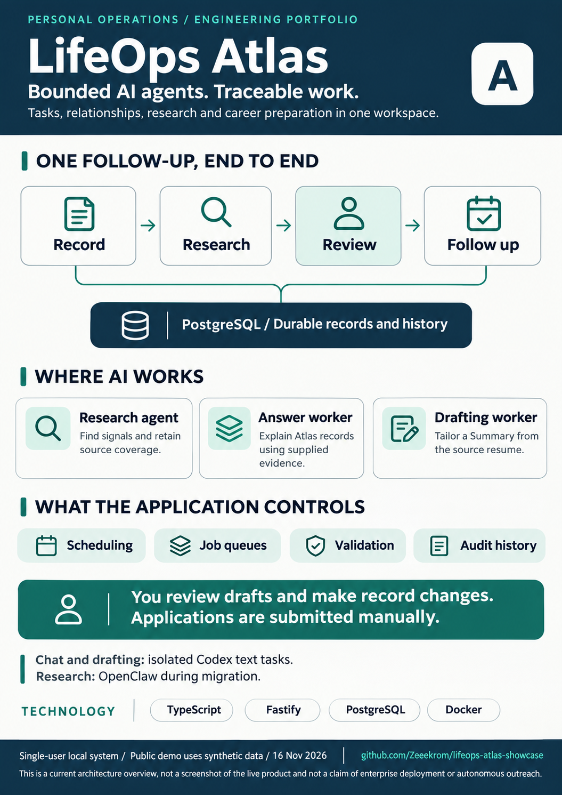
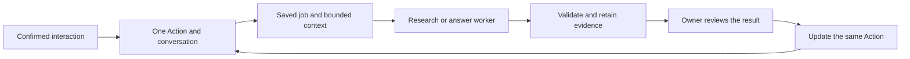
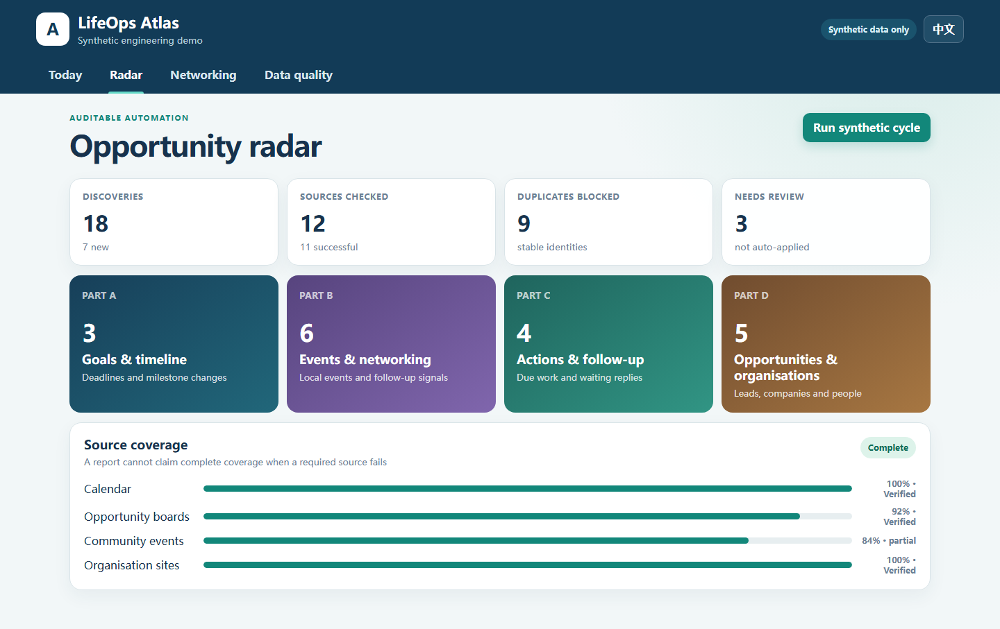
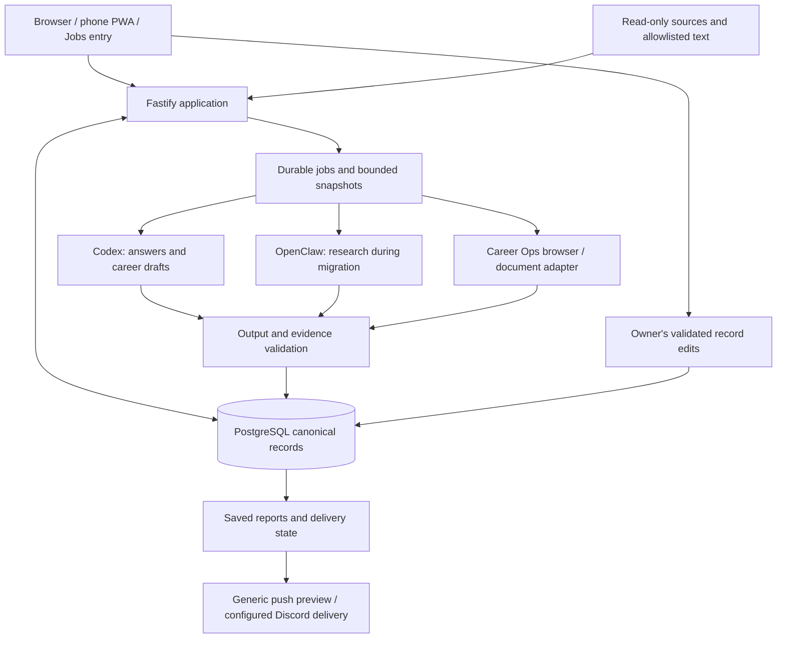

# LifeOps Atlas

<p align="right"><strong>English</strong> · <a href="README.zh-CN.md">简体中文</a></p>

> A personal operations workspace with bounded AI agents: research signals,
> explain records and prepare career drafts, while Atlas keeps the durable state.

[](https://github.com/Zeeekrom/lifeops-atlas-showcase/actions/workflows/validate.yml)

<table>
<tr>
<td align="center" width="68%"><a href="https://zeeekrom.github.io/lifeops-atlas-showcase/video/"></a></td>
<td align="center" width="32%"><a href="media/agent-workflow-poster.png"></a></td>
</tr>
<tr>
<td align="center"><a href="https://zeeekrom.github.io/lifeops-atlas-showcase/video/">64-second film · synthetic screens · October snapshot</a></td>
<td align="center"><a href="media/agent-workflow-poster.png">AI workflow poster · 16 Nov 2026</a></td>
</tr>
</table>

**[Open the synthetic demo](https://zeeekrom.github.io/lifeops-atlas-showcase/)** ·
**[Read the agent boundaries](docs/ai-agents.md)**

This is a sanitised portfolio edition of a private, single-user system.
It presents synthetic screens, engineering decisions and dated acceptance evidence.
Personal data, production prompts, resumes and account configuration stay private.
The demo runs locally in the browser; it does not run the production agents.

## Contents

- [At a glance](#at-a-glance)
- [The problem and who it is for](#the-problem-and-who-it-is-for)
- [One follow-up, start to finish](#one-follow-up-start-to-finish)
- [The screens](#the-screens)
- [Where the AI agents fit](#where-the-ai-agents-fit)
- [What works today](#what-works-today)
- [Problems that became rules](#problems-that-became-rules)
- [Architecture and data ownership](#architecture-and-data-ownership)
- [Technology stack](#technology-stack)
- [Verification evidence](#verification-evidence)
- [Dated operating and verification snapshot](#dated-operating-and-verification-snapshot)
- [Try the showcase](#try-the-showcase)
- [What is not finished](#what-is-not-finished)
- [Public versus private](#public-versus-private)

## At a glance

| | |
| --- | --- |
| What it is | One workspace for daily planning, relationship history, evidence-backed research, career preparation and application support |
| Primary user | One person maintaining their own schedule, contacts, follow-ups and source material |
| AI | A research-agent workflow, read-only answer workers and source-grounded drafting workers, coordinated through durable jobs |
| What the application owns | Scheduling, record identity, import reconciliation, validation, audit history and delivery state |
| Stack | TypeScript, Node.js 24, Fastify 5, Zod, PostgreSQL 17, Docker Compose, native web pages and a phone PWA |
| Current AI execution | Official Codex CLI for chat and career text; OpenClaw remains for Radar research and Discord during migration |
| Deployment | Local single-user installation; private phone access; public static showcase |
| Status | Documentation reviewed 16 Nov 2026. Implemented functions and dated checks are distinguished from deferred work |

## The problem and who it is for

A calendar records an appointment. A spreadsheet records a contact.
A chat produces a useful answer. None of those alone preserves what happened,
which source supports it, or what should happen next.

LifeOps Atlas joins those pieces around a durable record. A follow-up keeps its
identity when its reminder or status changes. A user correction survives the next
import. A research report shows which sources were read and which remain missing.

The working installation serves its owner. The public edition gives software,
data and application-support reviewers a reproducible view of the design.
Broader small-team use is a possible direction, not a validated deployment.

## One follow-up, start to finish

The example below is illustrative; it contains no private contact or message.



1. **Record the real starting fact.** The owner records an outgoing email and
   links it to a person and an Action.
2. **Set the right checkpoint.** An email follow-up can use the configured
   seven-calendar-day policy. Waiting on an unanswered LinkedIn message follows
   a separate policy without an automatic overdue countdown.
3. **Refresh the inputs.** One hourly coordinator reads permitted sources and
   reconciles them. Ordinary synchronization does not call an AI model.
4. **Run the appropriate worker.** A saved job supplies the relevant snapshot.
   Research records source coverage; conversation answers use supplied Atlas evidence.
5. **Keep the result checkable.** Validate the output and store the answer or
   report, evidence and available execution statistics. A saved report and a
   delivered notification have separate states.
6. **Let the owner decide.** Chat returns an explanation or draft. The owner
   edits the existing Action through the management screen and sends any message
   or application themselves. Later stages reuse the same record and conversation.

## The screens

| | |
| --- | --- |
|  |  |
| **Today:** schedule, Actions and weather | **Radar:** findings, source coverage and review state |
|  |  |
| **Networking:** relationships and interaction history | **Data quality:** identity review and conflicting evidence |

These four screens demonstrate selected patterns. They are synthetic fixtures,
not screenshots of personal records or an implementation of every private feature.

## Where the AI agents fit

The AI layer combines a research-agent workflow with narrower answer and drafting
workers. They share Atlas state and queues; each role has a different execution boundary.

| Role | What it does | What controls the result |
| --- | --- | --- |
| Research agent | Researches permitted public signals and prepares Radar sections with findings and source coverage | Durable jobs, required output contracts, identity reconciliation, bounded retries and explicit gaps |
| Answer worker | Explains the supplied Atlas snapshot, conversation and retrieved excerpts | Read-only chat; model text cannot execute a record change |
| Career drafting worker | Adapts a resume Summary and drafts ordinary application answers from supplied material | Source facts, Summary length checks, protected templates and separate application code |
| Evidence readers | Refresh selected local text and connected sources | Read-only manifests or approved connector operations; a connection alone is not successful coverage |
| Application coordinator | Schedules work, claims jobs, validates results and persists state | Deterministic application code, database constraints and audited management screens |

**The 15 November migration is partial.** Chat and career text now use the official
Codex CLI with the operator's ChatGPT subscription. Those calls use isolated
temporary workspaces, restricted filesystem/network permissions, disabled command
tools, web search, apps and plugins, and no paid-API or OpenClaw fallback.
Radar inference and Discord delivery/history still depend on OpenClaw.

Career browser prefill is a separate program, not a browser controlled by the
text model. Sensitive questions and final submission remain manual.
The ChatGPT handoff is an explicit copy/paste bridge; it does not search the
user's complete ChatGPT history.

[Agent roles, controls and acceptance](docs/ai-agents.md)

## What works today

| Workspace | Implemented work | Current boundary |
| --- | --- | --- |
| Today and follow-up | Agenda, local events, countdown policies, stable Actions, archive/reopen and reused conversations | Synced Calendar events are read-only; dates require a confirmed starting fact |
| Networking | People, organisations, interactions and identity review | LinkedIn is manual-only across all automation |
| Radar and AI technology | Source sampling, research jobs, reports, frozen evidence and personal relevance | Partial coverage stays partial; news is not personal experience |
| Knowledge and corpus | Allowlisted text ingestion, hashed sources, cited answers, draft review and protected writeback | Original attribution remains; raw material is not automatically an approved personal claim |
| Career preparation | Non-IT local SEEK pilot, saved JD, Summary copies, DOCX/PDF output and ordinary field prefill | Source templates stay unchanged; the user submits |
| IT Support and operations | Cases, service targets, assets, evidence, articles, Bug Log, PWA and generic notification previews | Second-device endpoint acceptance is deferred; the host must remain available |

[Full feature map](docs/feature-map.md) · [Engineering decisions](docs/engineering-decisions.md)

## Problems that became rules

| Failure or friction encountered | The resulting design |
| --- | --- |
| A later import could undo a manual correction | Keep source versions and explicit corrections separately; replay higher-authority corrections |
| Reopening the same Action could scatter its history across conversations | Reuse a stable Action-linked thread across status changes |
| A queued Radar job could look as though it was running | Separate queue, worker claim, report persistence and delivery; expose failures and retries |
| Model-generated change proposals were not a reliable editing surface | Retire executable chat cards; use validated management forms |
| A push preview could reveal private content before the phone connected privately | Send fixed generic preview text; load details inside Atlas |
| A provider or executable version could become unavailable | Preserve the saved request, classify the failure and make fallback policy explicit |

## Architecture and data ownership



The application and PostgreSQL run in two containers. Host workers and the
loopback bootstrap controller are separate processes. The phone, Jobs entry and
main dashboard use the same backend. Tailscale is optional for local use and
required for the configured private remote access.

Imported rows remain source evidence. Corrections, archive markers and Calendar
tombstones preserve confirmed user intent. Retrieval uses PostgreSQL text chunks
and lexical ranking; a separate vector database or embedding pipeline is not
part of the current implementation.

## Technology stack

| Layer | Technologies and purpose |
| --- | --- |
| API and contracts | TypeScript, Node.js 24, Fastify 5, Zod |
| Durable data and retrieval | PostgreSQL 17, constraints, source hashes, text chunks and lexical ranking |
| Interface | Native HTML/CSS/JavaScript, English/Chinese UI, PWA, Web Push |
| AI execution | Official Codex CLI for text; OpenClaw for the remaining research/delivery path |
| Career documents and browser | Selected Career Ops modules, Chromium automation and Python document handling |
| Local operations | Docker Compose, host workers, loopback recovery controller and optional private networking |
| Verification | Automated tests, isolated PostgreSQL checks, public-data validation and recorded acceptance |

## Verification evidence

| Dated check | Result and what it establishes |
| --- | --- |
| 15 Nov 2026: text migration | A real chat traversed the API, worker and database; its saved answer and execution receipt identified Codex |
| 15 Nov 2026: text boundaries | A synthetic adversarial request did not disclose an outside-workspace canary, perform the requested action or visit a URL; no tool event occurred |
| 15 Nov 2026: career generation | The actual Summary generator produced a source-grounded synthetic draft without editing a source resume or submitting an application |
| 15 Nov 2026: automated checks | The full-suite run recorded 342 passes and 18 conditional skips out of 360; five isolated PostgreSQL usage/read-only-chat checks also passed, reported separately |

These are specific acceptance observations, not a comprehensive security audit
or a promise of future uptime. Token receipts retain actual executor counters;
account quota and unavailable context capacity remain unknown.
[Verification definitions](docs/verification.md)

## Dated operating and verification snapshot

The older operating baseline remains **29 Oct 2026**. This repository has
**no live connection to the private production database**.

<table>
<tr>
<td align="center"><strong>160</strong><br><sub>Allowlisted text documents</sub></td>
<td align="center"><strong>418</strong><br><sub>Historical source records reconciled</sub></td>
<td align="center"><strong>288 / 295</strong><br><sub>Main-suite passes / total; 7 skips</sub></td>
<td align="center"><strong>27 / 27</strong><br><sub>Separate PostgreSQL checks passed</sub></td>
</tr>
</table>

The source snapshot also records three collections, 43 elapsed calendar days
since shadow comparison began, and one recommendation example with three outputs
from 22 evidence items. Calendar age is not measured uptime; import counts are
not sent messages, and recommendation counts are not career outcomes.
[Machine-readable baseline](docs/operating-snapshot.json)

## Try the showcase

```bash
npm run validate:public
npm test
npm run dev
```

Open <http://127.0.0.1:4173>. The static demo uses local synthetic data and has no
production backend or account connection.

The film retains its October screens and figures. The new poster illustrates
the architecture reviewed on 16 November; it does not publish record totals.
The [8 October poster](media/poster.jpg) remains an explicitly historical asset.

## What is not finished

- Migrate the remaining research and Discord dependencies before retiring OpenClaw.
- Decide and validate AWS/Azure deployment; the operational installation is still local.
- Complete second-device endpoint acceptance when that work resumes.
- Finish authenticated real-form acceptance for the career pilot; submission stays manual.
- Establish broader user validation and measured outcomes before claiming wider readiness.

## Public versus private

This repository does not share Git history with the private implementation.
It contains reviewed explanations, synthetic examples and selected aggregates.
Personal records, communications, resumes, source paths, credentials, production
prompts and runtime logs remain excluded.

The demo, film and old poster have their own dated scope. No deployment,
employment result, productivity gain or complete source coverage is inferred
from their existence.
[Publication boundary](docs/publication-boundary.md)

Copyright (c) 2026 LifeOps Atlas. All rights reserved.
See [LICENSE](LICENSE), [terms and privacy](https://zeeekrom.github.io/lifeops-atlas-showcase/terms/)
and [third-party notices](THIRD_PARTY_NOTICES.md).
Statutory exceptions, GitHub platform permissions and third-party licences remain applicable.
