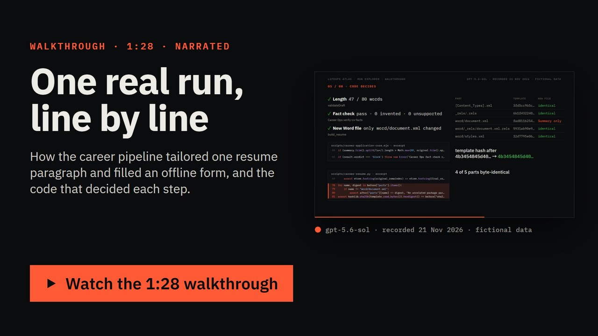
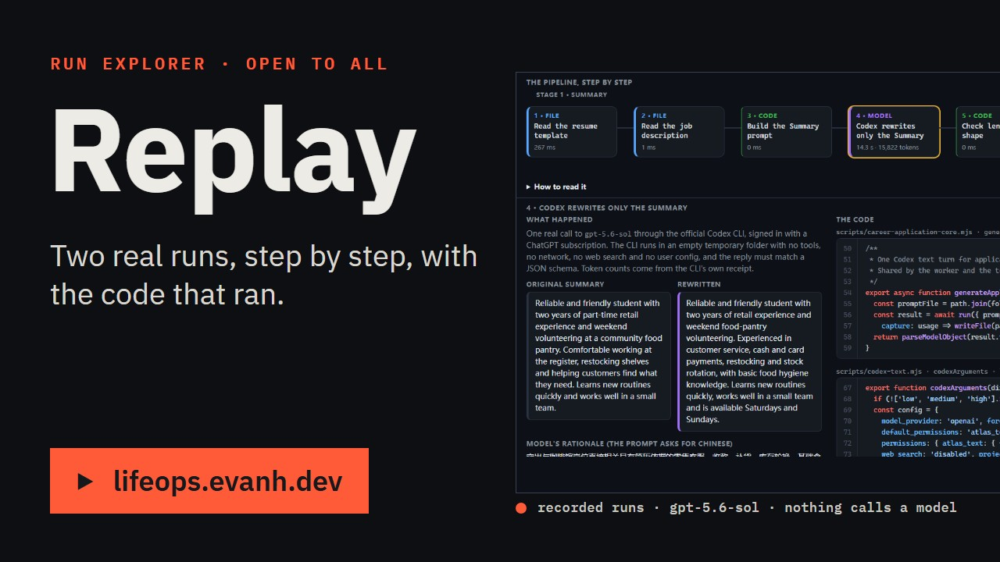
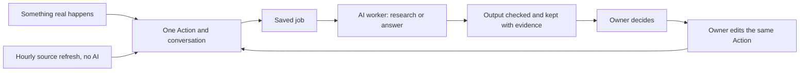
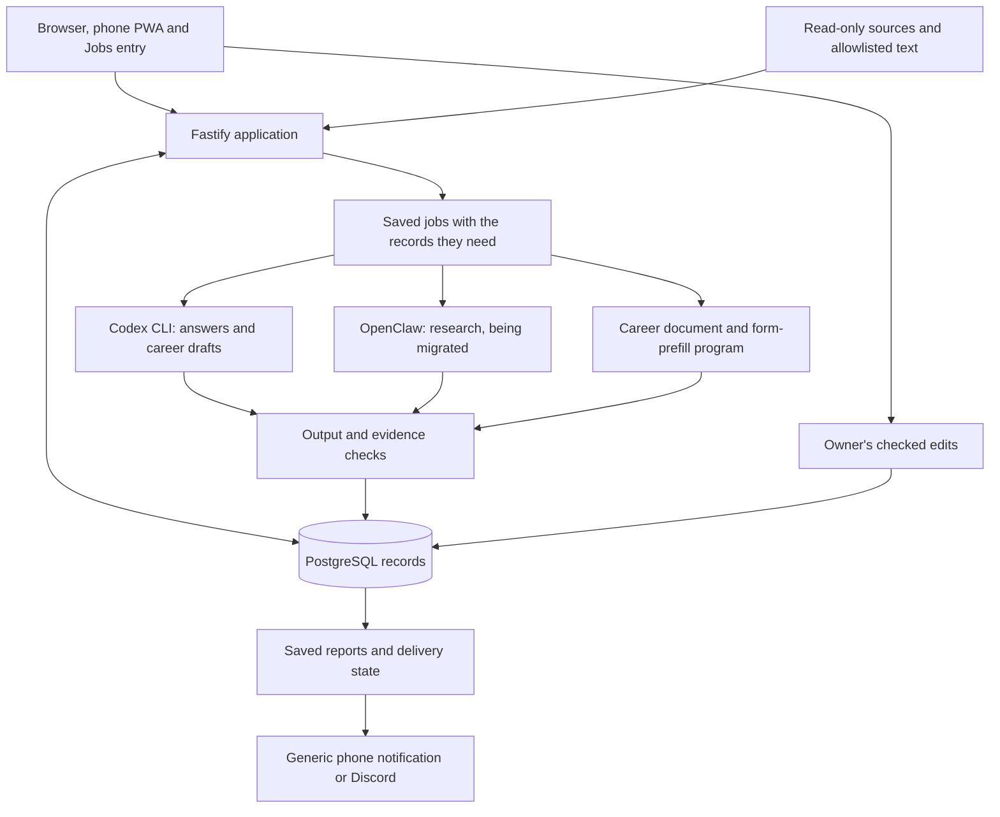

# LifeOps Atlas

<p><strong>English</strong> · <a href="README.zh-CN.md">简体中文</a></p>

[](https://github.com/Zeeekrom/lifeops-atlas-showcase/actions/workflows/validate.yml)


LifeOps Atlas keeps one reliable record of a person's schedule, contacts, follow-ups, opportunities and research, and shows where each fact came from. Its owner uses it to plan the day, follow up with people, watch for events and opportunities, and prepare job applications.

It is AI-assisted and application-controlled. AI workers research public sources, answer questions from the records and draft career text. The application decides what is kept: AI output is checked before it is saved, chat cannot change a record, and every message and application is sent by the owner.

This is a personal, single-user system running as one local installation. It is not a product, a cloud service or a CRM for a team.

The application source, real records, prompts and configuration live in a private repository. This repository is a sanitised portfolio edition: documents, dated results, a synthetic demo and synthetic screens only. No personal data is published here.

<table>
<tr>
<td><a href="https://zeeekrom.github.io/lifeops-atlas-showcase/video/"></a></td>
<td><a href="media/poster.jpg"></a></td>
</tr>
<tr>
<td align="center"><a href="https://zeeekrom.github.io/lifeops-atlas-showcase/video/">64-second film, October 2026</a></td>
<td align="center"><a href="media/poster.jpg">Poster, 16 Nov 2026</a></td>
</tr>
</table>

<table>
<tr>
<td><a href="https://lifeops.evanh.dev/walkthrough/"></a></td>
</tr>
<tr>
<td align="center"><a href="https://lifeops.evanh.dev/walkthrough/">Walkthrough: one real run, line by line, 1:28</a></td>
</tr>
</table>

<table>
<tr>
<td><a href="https://lifeops.evanh.dev/"></a></td>
</tr>
<tr>
<td align="center"><a href="https://lifeops.evanh.dev/">Replay: two recorded real runs, open to all</a></td>
</tr>
</table>

**Synthetic demo (sample data, preset responses):** [open the four-screen demo](https://zeeekrom.github.io/lifeops-atlas-showcase/)
— Today, Radar, Networking and Data quality, filled with made-up records. It runs in the browser with no backend,
no account and no AI call.

**Short film:** [watch the 64-second film](https://zeeekrom.github.io/lifeops-atlas-showcase/video/)
— a walkthrough of the synthetic screens. It was recorded in October 2026, so its screens and figures date from
then.

**Walkthrough:** [One real run, line by line](https://lifeops.evanh.dev/walkthrough/) ([中文](https://lifeops.evanh.dev/zh/walkthrough/))
— 1:28: one real run of the career-materials pipeline, recorded on 21 November 2026, with the code that decided each step.
Every number on screen comes from the run records. English narration (synthetic voice), English and Chinese subtitles.

**Interactive demo:** [Run Explorer](https://lifeops.evanh.dev/) ([中文](https://lifeops.evanh.dev/zh/))
— each step of the career-materials pipeline, with the data it handled and excerpts of the private implementation's code (commit `6bd7f5c`) that ran.
The replay shows two runs recorded on 21 November 2026, each with two real calls to gpt-5.6-sol through the official Codex CLI, and calls no model itself.
The candidate, employer and application form are fictional.


The synthetic Radar screen. A research run shows what it found, how many duplicates it dropped, which sources it checked (here 11 of 12 succeeded) and what is waiting for review. Findings that need review are not applied automatically, and a report cannot claim complete coverage when a required source fails. All values are made up.

## Contents

- [At a glance](#at-a-glance)
- [The problem](#the-problem)
- [Who it is for](#who-it-is-for)
- [One follow-up, start to finish](#one-follow-up-start-to-finish)
- [The screens](#the-screens)
- [Where the AI agents fit](#where-the-ai-agents-fit)
- [What works today](#what-works-today)
- [Design principles](#design-principles)
- [Real records and synthetic data](#real-records-and-synthetic-data)
- [How it was built](#how-it-was-built)
- [Problems that became rules](#problems-that-became-rules)
- [Technology stack](#technology-stack)
- [Verification evidence](#verification-evidence)
- [Try the showcase](#try-the-showcase)
- [Security and data boundary](#security-and-data-boundary)
- [What is not finished](#what-is-not-finished)
- [What the project showed](#what-the-project-showed)
- [Public versus private](#public-versus-private)
- [Copyright and terms](#copyright-and-terms)

## At a glance

| | |
|---|---|
| What it is | A personal operations system: schedule, follow-ups, relationships, research and career preparation in one database, with AI workers that read and draft but do not decide |
| Who it is for | One person who runs their own pipeline of contacts, events, opportunities and applications. This public edition is for software, data and application-support reviewers |
| The problem | A calendar, a spreadsheet and a chat window each hold part of the story. None of them keeps what happened, which source says so, or what should happen next, and an AI summary of them cannot be checked |
| AI | An evening research run that reports findings with the sources it read; read-only answers from the records; and career drafts grounded in the owner's own material. Since 15 Nov 2026, chat and career text run on the official Codex CLI in an isolated text-only mode. Since 20 Nov, the Radar's personalisation step runs there too and Discord delivery calls the Discord API directly. Research still runs on OpenClaw while that move finishes |
| Stack | TypeScript, Node.js 24, Fastify 5, Zod, PostgreSQL 17, Docker Compose, native HTML/CSS/JavaScript and a phone PWA |
| Evidence | 342 passes and 18 conditional skips in a 360-test run, a restricted-AI canary check with no tool event, and an end-to-end chat through the queue (15 Nov 2026); 418 historical records reconciled and 27 of 27 isolated PostgreSQL checks (29 Oct 2026) |
| Data | Real records stay in the private installation. This repository holds synthetic screens, a synthetic demo and a fixed-format file of dated counts |
| Status | One local installation used by its owner; shadow comparison began on 16 Sep 2026. Not a multi-user product and not deployed to the cloud. An [interactive demo](https://lifeops.evanh.dev/) (Nov 2026) replays real runs of the career pipeline on fictional data |

## The problem

Keeping track of your own pipeline means answering the same questions every day. Most tools answer only part of them:

- What is due today, and who am I waiting on?
- When did I last talk to this person, and what did I say I would do?
- Did the latest import just undo something I corrected by hand?
- Is this evening's research complete, or did some sources fail?
- Which statement came from me, which from a speaker at an event, and which from a news article?
- Can an AI answer from my records without being able to change them?

LifeOps Atlas answers them from one database and keeps the source of each fact beside it.

## Who it is for

LifeOps Atlas serves one person who runs their own pipeline: someone looking for work, building a network in a new city, or working independently. The table shows the questions it answers in each part of that work.

| Situation | The question | What Atlas shows |
|---|---|---|
| Planning the day | What is due, and what am I waiting on? | Today's agenda with open Actions (follow-up items), each with its own waiting rule |
| Following up with a person | When did we last talk, and what happens next? | One Action and one conversation per follow-up, kept through every status change |
| Watching for opportunities | What is new this evening, and which sources were actually read? | A Radar report with findings, dropped duplicates and per-source coverage |
| Preparing an application | Can the resume be tailored without touching the original? | A separate Summary copy drafted from the owner's material; the owner submits |
| Checking the data | Which records disagree, and why? | An identity review queue and a fixed order of which evidence wins |

The working installation serves its owner. Wider use, for example by a small team, is a possible direction that has not been built or tested.

## One follow-up, start to finish

The example is illustrative. It contains no private contact or message.



1. **Something real happens.** The owner records an email they sent and links it to a person and an Action.
2. **A checkpoint is set.** An email follow-up waits seven calendar days by default. An unanswered LinkedIn message follows its own rule, with no automatic overdue countdown.
3. **Sources refresh.** Once an hour a coordinator re-reads the permitted sources and reconciles them. No AI model is called.
4. **AI work runs as a saved job.** The job is saved before any model call, together with the records it needs. A research run records which sources it read; an answer uses only the records it was given.
5. **The result is checked and kept.** Output is validated, then stored with its evidence. A saved report and a delivered notification are tracked as separate states.
6. **The owner decides.** Chat returns an explanation or a draft. The owner edits the Action in a management form and sends any message or application themselves. The next stage reuses the same Action and conversation.

## The screens

| | |
|---|---|
|  |  |
| **Today.** The next two days and the Actions that are due | **Networking.** Where each relationship stands, and recent interactions |
|  |  |
| **Radar.** Findings, dropped duplicates and which sources were checked | **Data quality.** Unclear identities wait for review. They are not guessed |

These four screens come from the synthetic demo. They show selected patterns, not screenshots of personal records or every private feature.

## Where the AI agents fit

The AI layer is a research workflow plus two narrower text workers. They share Atlas's records and job queue, and each has a different boundary.

| Role | What it does | What controls the result |
|---|---|---|
| Research agent | Researches permitted public sources each evening and writes Radar sections with findings and source coverage | Saved jobs, a required output format, identity matching, limited retries and explicit gaps |
| Answer worker | Explains the records, conversation and text excerpts it is given | Chat is read-only; model text cannot change a record |
| Career drafting worker | Adapts a resume Summary and drafts ordinary application answers from the owner's material | Source facts, length checks, protected templates and separate application code |
| Source readers | Refresh selected local text and connected sources | Read-only lists of allowed files or approved connector operations; a connection alone is not a successful read |
| Application coordinator | Schedules work, claims jobs, checks results and saves state | Ordinary application code, database constraints and audited management forms |



**The 15 November move is partial.** Chat and career text now call the official Codex CLI with the owner's existing ChatGPT sign-in. Each call runs in a fresh temporary folder with restricted file and network access, and with command tools, web search, apps and plugins switched off. If it fails, it does not fall back to a paid API or to OpenClaw. Since 20 November, Discord delivery and history import call the Discord API directly with the existing bot, and the Radar's personalisation step uses the same Codex adapter. Radar research and commands sent to the bot in Discord still depend on OpenClaw.

Form prefill for applications is a separate program, not a browser driven by the text model. Sensitive questions and the final submission stay manual. Handing context to ChatGPT is an explicit copy and paste; it does not search the owner's ChatGPT history.

[Agent roles, controls and acceptance](docs/ai-agents.md)

## What works today

| Capability | Implemented |
|---|---|
| Today and follow-ups | Agenda, local events, stable Actions that can be archived and reopened, and conversations reused across stages |
| Follow-up timing | Dates start from a confirmed fact (sent, received, attended); local calendar days; manual dates are protected; each channel has its own waiting rule |
| Relationships | People, organisations, interactions and identity-review decisions with their evidence |
| Assistants | Seven saved assistant spaces, report history, text retrieval with citations and a copy-and-paste handoff to ChatGPT |
| Daily Radar | Four report sections, normally run at 6:00 pm Hobart time; queue, job claim, limited retries, per-source status and delivery history |
| AI technology Radar | Fixed samples of public APIs and feeds, with relevance notes tied to the evidence used |
| Knowledge and files | Three read-only collections of allowlisted text (160 documents on 29 Oct 2026), with source hashes; uploaded originals stored separately |
| Career preparation | A local SEEK pilot for non-IT roles: saved job description, Summary copy, DOCX/PDF output and ordinary form prefill. Master templates are never edited |
| IT support | Cases, priorities and service targets, assets, evidence, knowledge articles and a Bug Log |
| Phone and notifications | Phone PWA with Web Push; previews carry fixed generic text, and details open only over the private network |
| Operations | Two containers (application and PostgreSQL), host workers and a loopback-only recovery controller with allowlisted operations |

[Full capability map](docs/feature-map.md) · [Engineering decisions](docs/engineering-decisions.md)

## Design principles

- **The database remembers, not the prompt.** Current facts live in PostgreSQL with constraints and history. Prompts hold behaviour and output formats only.
- **An imported row is evidence, not truth.** The owner's corrections are stored separately and survive the next import.
- **AI reads and drafts. It does not change records.** Chat is read-only; edits go through checked management forms.
- **The job is saved before the model is called.** Quota, sign-in and network failures are normal, so a failed call leaves a saved request, not lost work.
- **A missing source stays missing.** Partial coverage is reported as partial, and a connected source is not counted as read until a run reads it.
- **Different kinds of evidence stay apart.** The owner's own experience, a speaker's claim, a report about someone else and technology news are separate source types. News never becomes a skill claim.
- **The owner sends.** Messages, applications and final submissions are always manual.
- **Notifications say nothing private.** A phone preview carries fixed generic text.
- **LinkedIn is manual only.** No automation touches it, signed in or not.

When sources disagree, this order decides: the owner's explicit confirmation or correction, then verified current evidence, confirmed records, imported source rows, prompt defaults, and model inference last.

## Real records and synthetic data

| Set | What it is | Where it is |
|---|---|---|
| Private records | People, organisations, interactions, events, opportunities, Actions and reports | The private installation only |
| Knowledge collections | 160 allowlisted text documents in three read-only collections (29 Oct 2026) | Private; only the count is published |
| Operating snapshot | Counts and dates from the 29 Oct 2026 acceptance record, in a fixed format with no room for names or text | [`docs/operating-snapshot.json`](docs/operating-snapshot.json) |
| Demo records | Made-up people, events, findings and reviews for the four screens | [`demo/data.json`](demo/data.json) |
| Screens, film and poster | Captured from the synthetic demo | [`media`](media), the film page |

The synthetic values show how the screens work. They say nothing about the owner's network, activity or results.

## How it was built

| Date | What changed |
|---|---|
| 16 Sep 2026 | First local installation; shadow comparison begins |
| 9 Oct 2026 | Public showcase and four-screen synthetic demo published |
| 29 Oct 2026 | Acceptance record: 160 documents indexed, 418 historical records reconciled, 288 of 295 tests passing and 27 of 27 isolated PostgreSQL checks. Phone PWA, career pilot, IT support cases and read-only knowledge published in the capability map |
| 7 Nov 2026 | 64-second film of the synthetic demo |
| 13 Nov 2026 | Copyright terms, privacy notes and crawler rules for the public site, in English and Chinese |
| 15 Nov 2026 | Chat and career text moved to the official Codex CLI in an isolated text-only mode; 342 of 360 tests passing, 18 skipped |
| 20 Nov 2026 | Discord delivery and history import moved off OpenClaw to the Discord API directly; the Radar's personalisation step moved to the Codex adapter |
| 21 Nov 2026 | Interactive demo, the Run Explorer, published at lifeops.evanh.dev: two recorded real runs of the career-materials pipeline on a fictional candidate, each step linked to the code that ran |

The two dated acceptance records, 29 Oct and 15 Nov, are described in [verification definitions](docs/verification.md).

## Problems that became rules

| What went wrong | What changed |
|---|---|
| A later import could undo a manual correction | Source versions and corrections are stored separately, and higher-ranked corrections are replayed on every import |
| Reopening the same Action could scatter its history across conversations | Each Action keeps one conversation through every status change |
| A queued Radar job could look as if it were running | Queue, worker claim, report saved and message delivered are separate states, and failures and retries are shown |
| AI-generated change proposals were not a reliable way to edit records | Executable chat cards were retired; edits go through checked management forms |
| A phone notification could show private content before the phone joined the private network | Notifications carry fixed generic text; details load inside Atlas |
| A provider or program version could stop working | The saved request is kept, the failure is classified, and any fallback is stated in policy rather than automatic |

## Technology stack

- TypeScript, Node.js 24, Fastify 5 and Zod contracts
- PostgreSQL 17 with constraints, source hashes, text chunks and lexical ranking (no separate vector database)
- Native HTML, CSS and JavaScript; English and Chinese interface; phone PWA with Web Push
- Official Codex CLI for text; the Discord API directly for delivery; OpenClaw for the remaining research path
- Selected Career Ops modules, Chromium automation and Python document handling for the career pilot
- Docker Compose, host workers, a loopback-only recovery controller and optional private networking (Tailscale)
- Automated tests, isolated PostgreSQL checks, public-data validation and dated acceptance records

See [Architecture](docs/architecture.md) for components and the data flow, and [Engineering decisions](docs/engineering-decisions.md) for the trade-offs.

## Verification evidence

Each check is a dated acceptance observation from the private installation. The runs and the code that reproduces them stay private; the results are published here.

- **15 Nov 2026, text move:** a real chat crossed the API, the queue, the Codex worker and the database; the saved answer and its usage receipt name Codex
- **15 Nov 2026, text boundaries:** a synthetic adversarial chat asked for a file outside the workspace, record changes and browsing. The canary value was not disclosed, nothing changed, no URL was visited and no tool event occurred
- **15 Nov 2026, career drafting:** the real Summary generator produced a grounded synthetic draft without editing a source resume or submitting an application
- **15 Nov 2026, automated tests:** 342 passes and 18 conditional skips out of 360; five isolated PostgreSQL checks of usage records and read-only chat also passed, reported separately
- **29 Oct 2026, operating snapshot:** see below

Skipped tests are not counted as passes. These are specific observations, not a full security audit or a promise of future uptime. [Verification definitions](docs/verification.md)

### Dated operating and verification snapshot

The operating baseline is dated **29 Oct 2026**. This repository has **no live connection to the private production database**.

<table>
<tr>
<td align="center"><strong>160</strong><br><sub>Allowlisted text documents</sub></td>
<td align="center"><strong>418</strong><br><sub>Historical source records reconciled</sub></td>
<td align="center"><strong>288 / 295</strong><br><sub>Main-suite passes / total; 7 skips</sub></td>
<td align="center"><strong>27 / 27</strong><br><sub>Separate PostgreSQL checks passed</sub></td>
</tr>
</table>

Of the 418 records, 264 matched existing records, 153 were added and one was archive-only. The snapshot also records three collections, 43 calendar days since shadow comparison began, and one recommendation example with three outputs from 22 evidence items. Calendar days are not measured uptime, import counts are not sent messages, and recommendation counts are not career outcomes. [Machine-readable snapshot](docs/operating-snapshot.json)

## Try the showcase

```bash
npm run validate:public
npm test
npm run dev
```

Open <http://127.0.0.1:4173>. The static demo uses local synthetic data and has no production backend or account connection.

To watch the career pipeline at work without running anything, open the [Run Explorer](https://lifeops.evanh.dev/).

## Security and data boundary

- The public demo has no backend, credentials or AI calls. It cannot reach the private installation.
- Codex calls are restricted one call at a time: a fresh temporary folder, no general file access, no command networking, and command tools, web search, apps, plugins and memory switched off. These settings reduce what a call can do; they are not a complete security assessment, and future CLI changes have not been tested.
- Chat cannot change a record, run an Action or send a message. The owner's edits go through the management forms and audited record managers, with identity and version checks; imports write source evidence, never over a correction.
- The recovery controller listens on the loopback address only and runs a fixed list of operations.
- Phone previews carry fixed generic text. Opening the details needs the private network.
- Public-source readers do not get around logins, robots rules or challenges. LinkedIn is manual-only throughout.
- It is built for one user. Multi-user access and multi-tenancy are not part of it.

## What is not finished

- Move Radar research and the remaining Discord commands off OpenClaw, then retire it.
- Decide on and test a cloud deployment (AWS or Azure); the working installation is still local.
- Finish acceptance on a second device when that work resumes.
- Finish signed-in acceptance on real application forms for the career pilot; submission stays manual.
- Test it with other users and measure outcomes before claiming it is ready for wider use.

## What the project showed

- A record you can correct is worth more than a summary you cannot check.
- Saving the job before calling the model turns an AI failure into a queued request, not lost work.
- Reporting which sources failed keeps a confident report honest.
- Keeping AI out of the write path made it safe to change providers: the move to Codex changed a worker, not the records.
- Keeping "what I did" apart from "what I read" stops a news item from turning into a resume claim.

## Public versus private

This repository does not share Git history with the private implementation. It contains reviewed explanations, synthetic examples and selected dated counts. Personal records, communications, resumes, source paths, credentials, production prompts and runtime logs stay out.

The [Run Explorer](https://lifeops.evanh.dev/) is the one place where implementation code is shown: for the career-materials pipeline only, it shows the functions each step ran and the prompts they built, as excerpts pinned to one commit of the private implementation, run on fictional data. The rest of the source stays private.

The demo, the film and the poster each carry their own date and scope. Nothing about deployment, job results, time saved or complete source coverage should be read into them. [Publication boundary](docs/publication-boundary.md)

## Copyright and terms

© 2026 LifeOps Atlas. All rights reserved; see [LICENSE](LICENSE). Without written permission, nothing in this repository may be copied, republished or adapted, and the project's code and design may not be rebuilt, whether by hand, with automated tools or with AI cloning tools. The code may not be reverse engineered except where the law allows, and the content may not be scraped, bulk-downloaded or used to train or evaluate AI models. Uses the law already allows, such as fair dealing for review or news reporting, are not affected. Sharing links is welcome. Statutory exceptions, GitHub's platform permissions and third-party licences still apply; see [third-party notices](THIRD_PARTY_NOTICES.md). Terms, licences and privacy: [terms page](https://zeeekrom.github.io/lifeops-atlas-showcase/terms/).
