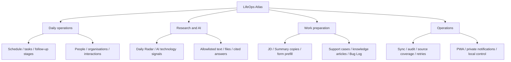
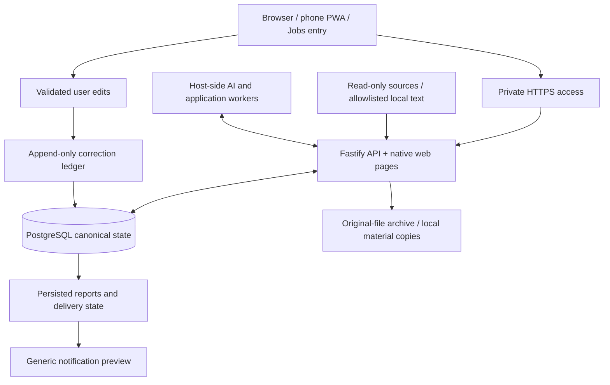

# LifeOps Atlas

<p align="right"><strong>English</strong> · <a href="README.zh-CN.md">简体中文</a></p>

> A single-user operations system that brings tasks, relationships, event
> research and career preparation into one evidence-backed workspace.
> Durable records belong in PostgreSQL; AI works from bounded, traceable input.

[](https://github.com/Zeeekrom/lifeops-atlas-showcase/actions/workflows/validate.yml)


**[Open the synthetic demo](https://zeeekrom.github.io/lifeops-atlas-showcase/)**

This is a deliberately sanitised portfolio edition: a static walkthrough,
engineering diagrams and selected dated aggregates. It contains no personal
data, production prompts, account identifiers or private configuration.
Every product screenshot comes from synthetic records. The production source
and real records remain private.

## At a glance

| Area | Current scope |
| --- | --- |
| Problem | Spreadsheet, calendar and chat outputs disagree; follow-ups lose their history and AI digests hide missing sources |
| Approach | One canonical database, append-only corrections, source evidence and durable worker jobs |
| Production stack | Node.js 24, TypeScript, Fastify 5, Zod, PostgreSQL 17 and Docker Compose |
| Interface | Native HTML/CSS/JavaScript, bilingual dashboard, phone PWA and a focused Jobs entry sharing the same backend |
| AI execution | Host-side workers with bounded snapshots, validated results and explicit provider failures |
| Deployment scope | One local single-user shadow installation; not a multi-tenant SaaS or a claim of continuous uptime |
| Public edition | Four synthetic screens plus architecture, capability boundaries and an aggregate acceptance snapshot |

## The system in blocks



[Feature map and boundaries](docs/feature-map.md) ·
[Architecture](docs/architecture.md) ·
[Engineering decisions](docs/engineering-decisions.md)

| Implemented in the private system | What it demonstrates | Practical limit |
| --- | --- | --- |
| Daily workspace and Action lifecycle | Stable IDs, archive/reopen, local-time checkpoints and correction replay | A stage needs a confirmed fact; a missing reply is not inferred from missing data |
| Research Radar | Durable jobs, source audits, bounded retries and reports stored before delivery | A blocked or unsearched source stays partial/unknown |
| AI technology Radar | Fixed API/feed sampling, immutable source snapshots and evidence-linked personal relevance | Not an exhaustive trending ranking; external news is not a user's skill or achievement |
| Text knowledge and file analysis | Read-only manifests, content hashes, scoped retrieval and preserved originals | No automatic whole-disk ingestion; extraction can fail |
| Seven assistant spaces | Persistent history, Action-linked conversations and explicit ChatGPT copy/paste handoff | Current chat is read-only; record changes use management screens |
| Career-preparation pilot | JD capture, template-preserving Summary copies, document outputs and ordinary field prefill | Non-IT local pilot; final submission is manual |
| Application support | Cases, priorities, service targets, evidence, knowledge articles and repair history | Not full enterprise endpoint management; second-device rollout remains unverified |
| Phone access and notifications | PWA subscription, generic previews and private-network detail access | Not a native mobile app; the host still needs to run |

All LinkedIn access is manual-only. Existing user-supplied/offline text can be
analysed, but the project does not automatically visit, search or scrape that
service. No account workaround is part of the design.

## Dated operating and verification snapshot

Selected observations from the private acceptance record dated **29 Oct 2026**.
This public repository has **no live connection to the private production
database**.

<table>
  <tr>
    <td align="center"><strong>43 days</strong><br><sub>Elapsed since shadow comparison began</sub></td>
    <td align="center"><strong>160</strong><br><sub>Allowlisted text documents indexed</sub></td>
    <td align="center"><strong>3</strong><br><sub>Read-only text collections</sub></td>
    <td align="center"><strong>418</strong><br><sub>Historical source records reconciled</sub></td>
  </tr>
  <tr>
    <td align="center"><strong>288 / 295</strong><br><sub>Main-suite passes / total; 7 conditional skips</sub></td>
    <td align="center"><strong>27 / 27</strong><br><sub>Isolated PostgreSQL acceptance tests passed</sub></td>
    <td align="center"><strong>3</strong><br><sub>Recommendations in one acceptance example</sub></td>
    <td align="center"><strong>22</strong><br><sub>Frozen evidence items in that example</sub></td>
  </tr>
</table>

- The 43-day interval is 16 Sep–29 Oct 2026: calendar age, **not measured uptime,
  active-use hours or a service-availability percentage**.
- The history import matched 264 source records to existing reports, added
  153 messages and retained one record without importable text. Replaying it
  does not duplicate the same records. These are import counts, not sent messages.
- The 27 real-database tests were run separately against an isolated test
  database. Seven conditional skips in the main suite are not counted as passes.
- The recommendation example records its input evidence. It is not a daily
  output rate, a claim of personal achievement or a measured career outcome.

[Machine-readable aggregate snapshot](docs/operating-snapshot.json) ·
[Definitions and verification limits](docs/verification.md)

The earlier business-record totals are not relabelled as current. The poster
below retains its original October snapshot and is historical material.

## Architecture and data ownership



The application and database are two containers. AI workers, browser prefill
and the local bootstrap controller run on the host. A stopped main application
is recovered through that separate controller. The phone, Jobs entry and main
dashboard share state; they do not maintain competing databases.

Imported rows are source evidence. A confirmed user correction is stored
separately and replayed after later imports. Deleted calendar events retain
tombstones. Follow-up stages keep the same Action identity instead of deleting
and recreating work. The text index currently uses PostgreSQL chunks and
lexical ranking, without a separate vector database.

## Where AI participates

AI helps with Radar analysis, cited conversation answers, bounded relevance
recommendations and tailored Summary drafts. Scheduling, ordinary sync,
deduplication, state transitions and dashboard figures are deterministic code.

A model answer cannot claim an external action happened or overwrite a record.
Chat is currently read-only. Manual management screens use the audited record
managers. The ChatGPT handoff copies context for the user to paste and send;
returned text remains external evidence.

Source gaps, provider failures, missing evidence and failed text extraction
stay visible. Notification previews carry generic copy rather than names,
task text, counts or report details. Opening details needs private access.

## Synthetic walkthrough

| | |
| --- | --- |
|  |  |
| Today: schedule, actions and weather | Radar: synthetic findings and source coverage |
|  |  |
| Networking: relationship stages and provenance | Data quality: identity review and evidence authority |

The four screens illustrate selected patterns. They do not implement every
private capability listed above. Displayed names, jobs and numbers in the
demo are synthetic and separate from the dated aggregate snapshot.

```bash
npm run validate:public
npm test
npm run dev
```

Open <http://127.0.0.1:4173>. The static walkthrough has no production backend
and no external account connection. It loads its synthetic data locally.

## Current limits

- Single-user, host-dependent shadow deployment; no multi-tenant access model
  or cloud availability claim.
- Read-only source access does not prove each run read every connected source.
  Source checks are bounded and can remain partial.
- No automatic applications, outreach, registrations or LinkedIn automation.
- No completed enterprise endpoint rollout, native Android application or
  automatic conversion of raw recordings into approved personal achievements.
- No published conversion, employment or time-saving outcomes; the snapshot
  demonstrates operating scale and specific acceptance evidence only.

## Historical poster


The poster uses the **8 Oct 2026** operating snapshot. Its counts and earlier
feature descriptions are historical; the current capability table and dated
snapshot above take precedence.

## Public versus private

This repository **does not share Git history** with the private implementation.
It is not an automatic mirror. Generic design descriptions, selected numeric
aggregates and synthetic examples are reviewed independently before publication.
Personal records, resumes, communications, source paths, production prompts,
account identifiers and runtime material stay excluded.

[Publication boundary](docs/publication-boundary.md) defines the release check.
Public validation supplements human review; it is not a proof that every
possible sensitive string can be detected automatically.

No reuse licence is currently granted. Public visibility supports technical
review and portfolio evaluation.
