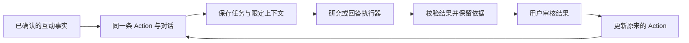
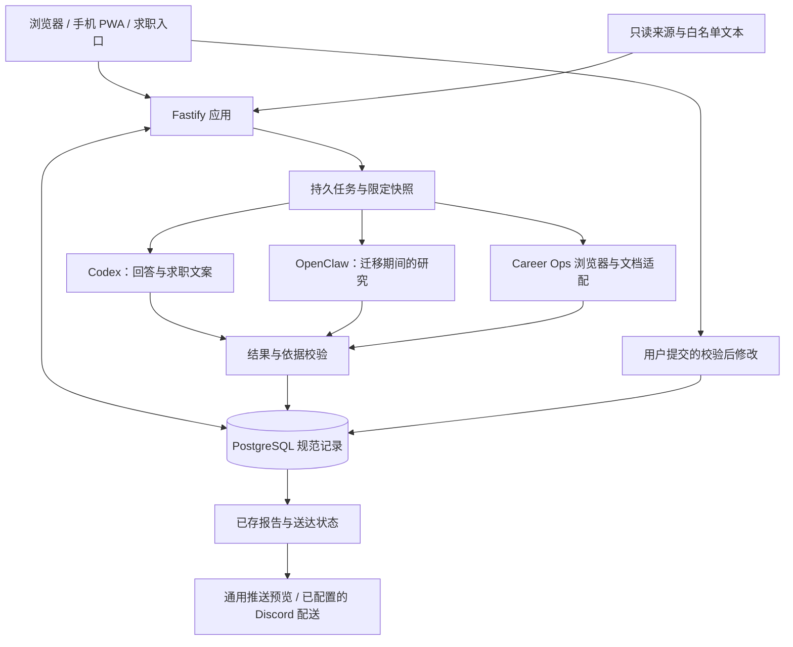

# LifeOps Atlas

<p align="right"><a href="README.md">English</a> · <strong>简体中文</strong></p>

> 一个带有受限 AI 智能体的个人运营工作台：研究新线索、解释已有记录、准备求职文案，
> 由 Atlas 保存持久状态和处理历史。

[](https://github.com/Zeeekrom/lifeops-atlas-showcase/actions/workflows/validate.yml)

<table>
<tr>
<td align="center" width="68%"><a href="https://zeeekrom.github.io/lifeops-atlas-showcase/video/"></a></td>
<td align="center" width="32%"><a href="media/agent-workflow-poster.png"></a></td>
</tr>
<tr>
<td align="center"><a href="https://zeeekrom.github.io/lifeops-atlas-showcase/video/">64 秒短片 · 合成界面 · 十月快照</a></td>
<td align="center"><a href="media/agent-workflow-poster.png">AI 流程海报 · 2026-11-16</a></td>
</tr>
</table>

**[打开合成数据演示](https://zeeekrom.github.io/lifeops-atlas-showcase/)** ·
**[查看智能体边界](docs/ai-agents.md#中文说明)**

这里是私有单用户系统经过筛选的作品集版本，展示合成界面、工程决策和注明日期的验收证据。
个人记录、生产提示词、简历和账号配置保留在私有环境。公开演示在浏览器中使用合成数据，
不会运行私人系统里的智能体。

## 目录

- [项目概况](#项目概况)
- [问题与使用对象](#问题与使用对象)
- [一条跟进从头到尾](#一条跟进从头到尾)
- [系统界面](#系统界面)
- [AI 智能体在什么位置](#ai-智能体在什么位置)
- [目前已经实现什么](#目前已经实现什么)
- [从问题变成的规则](#从问题变成的规则)
- [架构与数据归属](#架构与数据归属)
- [技术栈](#技术栈)
- [验收证据](#验收证据)
- [注明日期的运行与验收快照](#注明日期的运行与验收快照)
- [运行公开演示](#运行公开演示)
- [尚未完成的部分](#尚未完成的部分)
- [公开版与私有版边界](#公开版与私有版边界)

## 项目概况

| | |
| --- | --- |
| 这是什么 | 把每日安排、关系历史、有来源的研究、求职准备和应用支持放在一起的工作台 |
| 主要用户 | 维护自己日程、联系人、跟进事项和资料的单个使用者 |
| AI 的作用 | 研究智能体流程、只读回答执行器、基于来源的文案执行器，通过持久任务协调 |
| 程序负责什么 | 调度、记录身份、导入对账、结果校验、审计历史和送达状态 |
| 技术栈 | TypeScript、Node.js 24、Fastify 5、Zod、PostgreSQL 17、Docker Compose、原生网页和手机 PWA |
| 当前 AI 执行方式 | 聊天和求职文字使用官方 Codex CLI；迁移期间雷达研究与 Discord 仍依赖 OpenClaw |
| 部署 | 本机单用户系统、私有手机访问、公开静态作品集 |
| 状态 | 文档核对日期：2026-11-16。已实现、已验收和暂缓事项分别说明 |

## 问题与使用对象

日历保存一个约定，表格保存一个联系人，聊天生成一段有用的回答。
但这些东西分开时，很难保留“发生了什么、依据在哪里、下一步是什么”。

LifeOps Atlas 用持久记录把它们连起来。跟进事项改提醒、改状态后仍是同一条记录；
人工修正不会被下一轮导入盖掉；研究报告会说明实际读过哪些来源，还有哪些缺口。

实际运行实例服务于项目所有者。公开版让软件、数据和应用支持方面的评审者检查设计。
更广泛的小团队使用是后续方向，尚未经过用户部署验证。

## 一条跟进从头到尾

下面是示意流程，不含真实联系人的信息或消息。



1. **先记录真实起点。** 用户记录一封已经发出的邮件，关联人物和 Action。
2. **按类别设置复查点。** 邮件跟进可使用配置中的七个自然日规则；
   等待对方回复领英消息采用独立规则，不自动生成逾期倒计时。
3. **刷新输入。** 一个每小时运行的协调器读取允许的来源并对账，普通同步不调用 AI。
4. **交给对应执行器。** 已保存的任务带入限定快照。研究记录来源覆盖情况，
   对话回答使用系统提供的 Atlas 依据。
5. **留下可以检查的结果。** 校验并保存回答或报告、来源以及实际返回的执行统计。
   报告保存和通知送达是不同状态。
6. **由用户决定下一步。** 聊天给出解释或草稿，用户通过管理页面更新原来的 Action，
   自己发送消息或提交申请。后续阶段继续复用这条记录和对话。

## 系统界面

| | |
| --- | --- |
|  |  |
| **今日：** 日程、Action 和天气 | **雷达：** 发现、来源覆盖和待复核状态 |
|  |  |
| **Networking：** 人物关系和互动历史 | **数据质量：** 身份审核和冲突证据 |

这四个页面展示部分设计模式，使用合成数据，不是私人记录截图，
也没有把所有私有功能都实现在静态演示里。

## AI 智能体在什么位置

AI 层包含一个研究智能体流程，以及范围更窄的回答和文案执行器。
它们共用 Atlas 状态和任务队列，各自的执行边界不同。

| 角色 | 实际负责什么 | 结果由什么约束 |
| --- | --- | --- |
| 研究智能体 | 从允许的公开来源研究新信号，生成含发现和来源覆盖的雷达章节 | 持久任务、输出协议、身份对账、有上限重试和明确的来源缺口 |
| 回答执行器 | 解释传入的 Atlas 快照、对话记录和检索片段 | 聊天只读，模型文字不能执行记录修改 |
| 求职文案执行器 | 根据提供的材料改写简历 Summary，草拟普通申请字段答案 | 来源事实、长度检查、受保护模板和独立的申请程序 |
| 证据读取器 | 刷新选定的本地文本和已连接来源 | 只读清单或批准的连接器操作；连上不等于本轮成功读取 |
| 应用协调器 | 调度、领取任务、校验和保存结果 | 确定性程序、数据库约束和带审计的管理页面 |

**11 月 15 日完成的是部分迁移。** 聊天和求职文字已改用官方 Codex CLI，
使用所有者的 ChatGPT 订阅。这些调用采用独立临时工作区和受限文件／网络权限，
关闭命令工具、网页搜索、应用和插件，不会失败后偷偷改走付费 API 或 OpenClaw。
雷达推理、Discord 发送和历史读取仍依赖 OpenClaw。

求职网页预填由独立程序执行，文案模型不控制浏览器。敏感问题和最终提交保留给用户。
ChatGPT 交接是明确的复制粘贴流程，不会搜索用户全部 ChatGPT 历史。

[智能体分工、控制与验收说明](docs/ai-agents.md#中文说明)

## 目前已经实现什么

| 工作区 | 已实现的内容 | 当前边界 |
| --- | --- | --- |
| 今日与跟进 | 日程、本地活动、倒计时规则、稳定 Action、归档／重开、对话复用 | 已同步的 Calendar 活动只读；日期需要确认的起点事实 |
| Networking | 人物、机构、互动和身份复核 | 所有自动化入口都禁止访问领英 |
| 雷达与 AI 技术 | 来源采样、研究任务、报告、冻结依据、个人相关性分析 | 部分覆盖仍是部分覆盖；新闻不是个人经历 |
| 知识与个人语料 | 白名单文本接入、来源指纹、带引用回答、草稿审核和受保护回写 | 保留原始归属；原料不会自动变成已认可的个人能力声明 |
| 求职准备 | 本地非 IT SEEK 试点、保存 JD、Summary 副本、DOCX/PDF 和普通字段预填 | 不改源模板；由用户提交申请 |
| IT Support 与运维 | 工单、服务目标、资产、证据、文章、Bug Log、PWA 和通用通知预览 | 第二台设备验收暂缓；主机需要可用 |

[完整功能地图](docs/feature-map.md) · [工程决策](docs/engineering-decisions.md)

## 从问题变成的规则

| 实际遇到的问题或摩擦 | 形成的设计 |
| --- | --- |
| 后续导入可能覆盖人工修正 | 来源版本与明确修正分开保存，对账时重放优先级更高的修正 |
| 再次打开同一 Action 容易把历史散落到多个对话 | Action 关联稳定对话，状态改变后继续复用 |
| 排队任务容易看起来像一直在运行 | 分开显示排队、执行器领取、报告保存和送达，并暴露失败与重试 |
| 模型生成的修改建议不适合作为可靠编辑入口 | 停用可执行聊天卡片，改用校验过的管理表单 |
| 手机未连私有网络时，通知预览仍可能泄露内容 | 只推送固定通用文字，详情在 Atlas 内打开 |
| 服务商或程序版本失效 | 保留已保存请求，分类失败原因，明确备用执行策略 |

## 架构与数据归属



应用和 PostgreSQL 运行在两个容器中，主机执行器和本机恢复控制器是独立进程。
手机、求职入口和主界面使用同一后台。本机使用不依赖 Tailscale，
配置中的私有远程访问才需要它。

导入行保留为来源证据。修正、归档标记和 Calendar 删除标记保留用户确认的意图。
检索采用 PostgreSQL 文本分块和词项排序，当前实现不包含独立向量数据库或 embedding 流水线。

## 技术栈

| 层次 | 技术和用途 |
| --- | --- |
| API 与数据协议 | TypeScript、Node.js 24、Fastify 5、Zod |
| 持久数据与检索 | PostgreSQL 17、约束、来源指纹、文本分块和词项排序 |
| 界面 | 原生 HTML/CSS/JavaScript、英中界面、PWA、Web Push |
| AI 执行 | 官方 Codex CLI 处理文字；OpenClaw 保留在研究／配送链路 |
| 求职文档与浏览器 | 复用部分 Career Ops 模块、Chromium 自动化、Python 文档处理 |
| 本机运维 | Docker Compose、主机执行器、回环地址恢复控制器和可选私有网络 |
| 验证 | 自动化测试、隔离 PostgreSQL 检查、公开数据校验和验收记录 |

## 验收证据

| 日期与检查 | 结果和能证明的范围 |
| --- | --- |
| 2026-11-15：文字迁移 | 真实聊天经过 API、执行器和数据库，保存的回答和用量记录标明 Codex |
| 2026-11-15：文字执行边界 | 合成对抗请求未泄露工作区外的测试值，未执行请求的操作或访问链接，没有工具事件 |
| 2026-11-15：求职生成 | 实际 Summary 生成器完成有来源的合成文案，没有修改源简历或提交申请 |
| 2026-11-15：自动检查 | 完整测试当次为 360 项：342 项通过、18 项条件跳过；另有 5 项隔离 PostgreSQL 用量／只读聊天检查通过，分别统计 |

这些是具体检查的结果，不是全面安全审计或未来在线承诺。
Token 记录保留执行器实际统计，账户额度和未返回的上下文容量继续显示未知。
[验证定义](docs/verification.md)

## 注明日期的运行与验收快照

旧运行基线继续标为 **2026 年 10 月 29 日**。
公开仓库**不会实时连接私人生产数据库**。

<table>
<tr>
<td align="center"><strong>160</strong><br><sub>白名单文本数量</sub></td>
<td align="center"><strong>418</strong><br><sub>已对账的历史源记录</sub></td>
<td align="center"><strong>288 / 295</strong><br><sub>主测试通过／总数；7 项跳过</sub></td>
<td align="center"><strong>27 / 27</strong><br><sub>另一组 PostgreSQL 检查通过</sub></td>
</tr>
</table>

来源快照还记录了三个集合、影子对比开始后的 43 个自然日，
以及一次用 22 项依据生成三条建议的样例。自然日跨度不是在线时长，
导入数量不是发送量，建议数量也不是求职效果。
[可读取的基线快照](docs/operating-snapshot.json)

## 运行公开演示

```bash
npm run validate:public
npm test
npm run dev
```

打开 <http://127.0.0.1:4173>。静态演示只使用本地合成数据，没有生产后台或账号连接。

短片保留十月的界面和数字；新海报展示 11 月 16 日核对过的架构，不发布业务记录数量。
[10 月 8 日旧海报](media/poster.jpg)作为明确标注的历史材料保留。

## 尚未完成的部分

- 先迁移剩余研究和 Discord 依赖，再停用 OpenClaw。
- 决定并验收 AWS／Azure 部署，目前运营实例仍在本机。
- 恢复相关工作后，再完成第二台设备的端点实机验收。
- 完成求职试点中登录后真实申请表的验收，最终提交继续由人工完成。
- 获得更广泛的用户验证和效果数据后，再判断能否扩大使用范围。

## 公开版与私有版边界

本仓库与私有实现**没有共享 Git 历史**，只放审核过的说明、合成示例和选定汇总。
个人记录、通信、简历、来源路径、凭据、生产提示词和运行日志不会放进来。

演示、短片、旧海报各有自己的时间与范围，不能由其存在推断云端部署、
录用结果、效率收益或完整来源覆盖。
[公开边界说明](docs/publication-boundary.md)

Copyright (c) 2026 LifeOps Atlas. All rights reserved.
详见 [LICENSE](LICENSE)、[条款与隐私](https://zeeekrom.github.io/lifeops-atlas-showcase/terms/)
和[第三方声明](THIRD_PARTY_NOTICES.md)。法律允许的例外、GitHub 平台权限及第三方原许可仍然适用。
