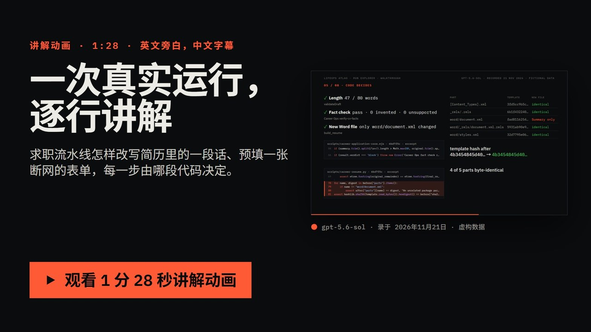
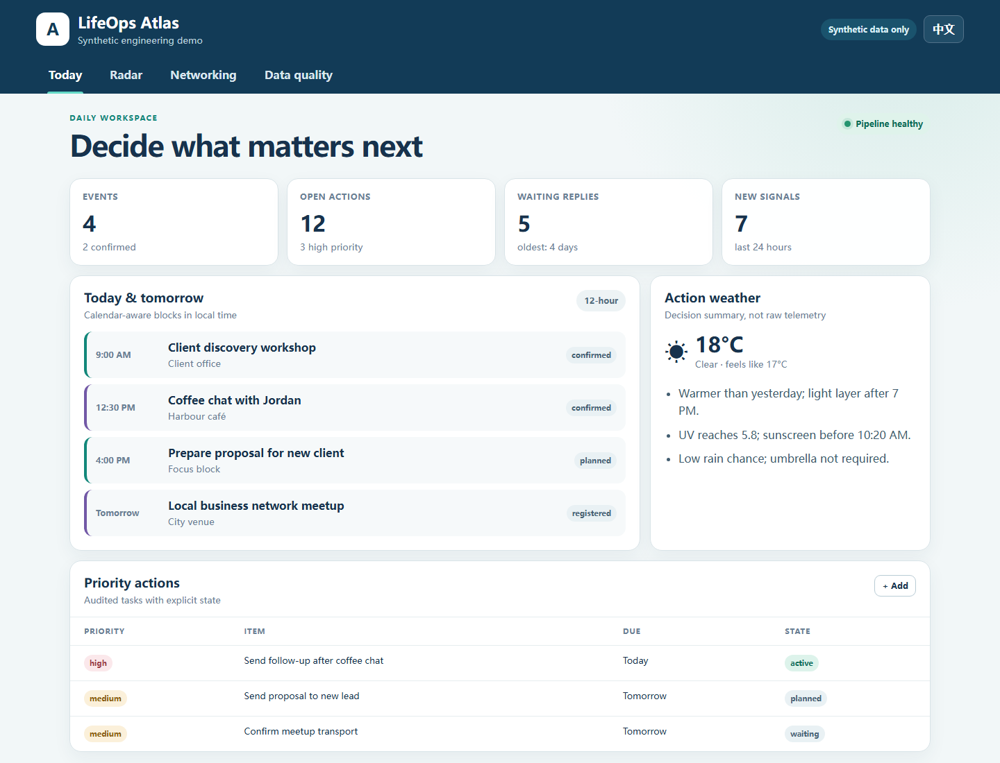
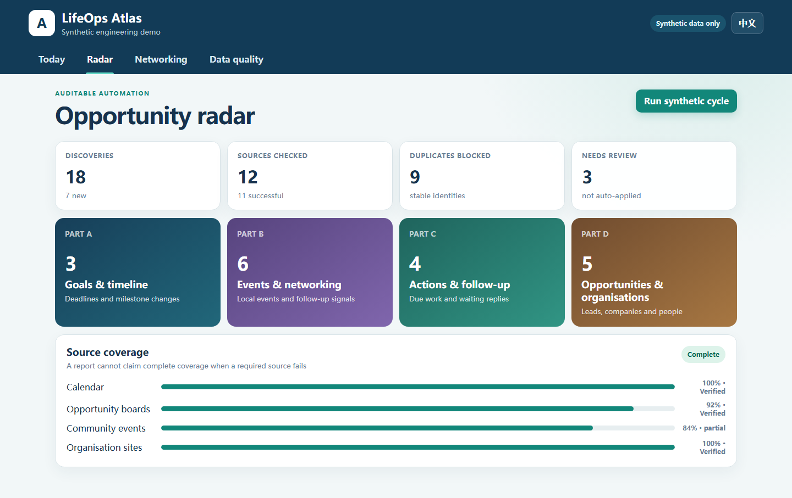

# LifeOps Atlas

<a href="README.md">English</a> · <strong>简体中文</strong>

个人运营系统：联系人、跟进和机会都在一份核对过的记录里；AI 起草，代码决定，本人发送。

<table>
<tr>
<td align="center" width="50%"> <b>短片</b> · 1:04</td>
<td align="center" width="50%"> <b>海报</b></td>
</tr>
<tr>
<td align="center" width="50%"> <b>代码讲解</b> · 1:28</td>
<td align="center" width="50%"> <b>回放</b> · 所有人可看</td>
</tr>
</table>

**能看到什么**

- **模型只改一段，其余由代码决定。** 它只能改简历的 Summary 一段。字数上限、对照简历的事实检查和对 Word 文件的逐字节保护决定草稿能不能用；文件五个部件里四个逐字节不变。→ [讲解动画](https://lifeops.evanh.dev/zh/walkthrough/) · [回放第 7 步](https://lifeops.evanh.dev/zh/?run=run-1&step=7)
- **敏感问题留给人。** 在一张断网的表单上，工作权利、薪资和确认框不管模型怎么说都留给本人填，提交也被拦住：两次运行的提交次数都是零。→ [回放第 12 步](https://lifeops.evanh.dev/zh/?run=run-1&step=12)
- **真实调用模型，有限制也有回执。** 每次运行通过官方 Codex CLI 调用两次 gpt-5.6-sol，关掉工具、网络和网页搜索，回复必须符合 JSON 结构；token 数是 CLI 自己的回执。→ [回放第 4 步](https://lifeops.evanh.dev/zh/?run=run-1&step=4)
- **四个页面，全是编出来的记录。** 今日、雷达、人脉和数据质量在浏览器里运行，用示例数据和预设回答：没有后台、没有账号，也不调用 AI。→ [合成数据演示](https://zeeekrom.github.io/lifeops-atlas-showcase/)

展示版：示例数据，源码不公开。源码和代码导览可约看：[领英私信我](https://www.linkedin.com/in/evan-h-165976301/)，或发邮件到 [yuxianghuang2026@gmail.com](mailto:yuxianghuang2026@gmail.com)。→ [公开版与私有版边界](#公开版与私有版边界) · [版权与条款](#版权与条款)

## 要解决的问题

日历、表格和聊天窗口各记着事情的一部分。自己管一条联系人、活动、机会和求职的线，每天都要回答同样几个问题：

- 今天该做什么？我在等谁回复？
- 上次和这个人聊是什么时候？我答应过要做什么？
- 最新一次导入，是不是把我手动改过的内容又盖掉了？
- 今晚的研究完整吗？有没有来源读取失败？
- AI 能不能根据我的记录回答问题，同时又没有权限改记录？

LifeOps Atlas 用同一个数据库回答这些问题，并把每条信息的来源存在旁边。

## 给谁用

自己管一条线的人：找工作的、在新城市建立人脉的、独立做事的。现在这一套实例由使用者自己在用；给小团队用是可能的方向，还没做也没测过。

## 一条跟进从头到尾

下面是示意，不含任何真实联系人或消息。

1. **真实的事发生了。** 使用者记下自己发出的一封邮件，关联到一个人和一条 Action。
2. **设好复查点。** 邮件跟进默认等七天；每种渠道有自己的规则。
3. **刷新来源。** 每小时重新读取允许的来源并对账，不调用 AI 模型。
4. **AI 工作作为保存好的任务运行。** 调用模型之前先把任务存下来。研究运行会记下读过哪些来源；回答只用交给它的那些记录。
5. **校验并保存结果**，连同依据一起保存。“报告已保存”和“通知已送达”分开记录。
6. **由使用者决定。** 聊天给出解释或草稿；使用者自己改这条 Action，消息和申请都由本人发出。

## 怎么保证靠谱

- **AI 只读和起草，从不改记录。** 聊天是只读的，修改走经过校验的表单，每条消息、每份申请都由本人发出。
- **手动改过的内容，下次导入不会被盖掉。** 导入的数据只是证据；使用者的更正单独保存，优先生效。
- **失败只留下一条请求，不会丢掉工作。** 调用模型之前先把任务存下来；调用失败会被归类并报告，不会悄悄换到别的服务商。
- **缺的来源就是缺。** 有必需来源失败时，报告不能显示为覆盖完整。
- **真实数据存在本机。** 真实记录存在本人的电脑上，不放云端数据库，手机只能通过私有网络打开；调用模型时只交给它这项任务需要的记录；这里公开的都是合成数据。手机通知只带固定的通用文字，任何自动化都不碰领英；公开的内容都要过一道自动检查，查有没有私人信息和密钥。
- **自动化按规则跑，每次都留记录。** 每晚的研究按时自动开始，跟进日期和提醒按固定规则排；但发给别人的任何东西都要本人亲自发出。每次运行都记下读了哪些来源、哪些失败、报告有没有送达。

## 系统界面

| | |
|---|---|
|  |  |
| **今日。** 接下来两天的安排和到期的 Action | **人脉。** 每段关系进行到哪一步，以及最近的互动 |
|  |  |
| **雷达。** 发现、去掉的重复项和检查过的来源 | **数据质量。** 认不准的身份等人复核，不靠猜 |

来自合成数据演示：展示部分设计，不是个人记录的截图。所有数字都是编的。

## 现在能做什么、不能做什么

- **已经能用**：本机一套实例，由使用者自己在用（影子对比从 2026 年 9 月 16 日开始）：日程和跟进、人脉、每晚的研究雷达、基于记录的只读聊天、求职文字起草和普通表单预填、IT 支持工单，以及带通知的手机应用。聊天和求职文字走官方 Codex CLI；研究还在 OpenClaw 上，迁移没做完。
- **还没做**：上云部署、第二台设备、在真实申请表上登录后的验收，以及给别人试用。
- **不是产品**：这是个人单用户系统，不是云服务，也不是团队 CRM。2026 年 10 月 29 日验收记录里的计数见 [`docs/operating-snapshot.json`](docs/operating-snapshot.json)。

## 想看更多

源码、通话里的代码导览、架构、决策记录、测试和提示词都不在这里公开，可以约看：[领英私信我](https://www.linkedin.com/in/evan-h-165976301/)，或发邮件到 [yuxianghuang2026@gmail.com](mailto:yuxianghuang2026@gmail.com)。

## 公开版与私有版边界

应用源码、真实记录、提示词和配置都在私有仓库里。本仓库是经过筛选的作品集展示版，与私有实现**没有共享 Git 历史**，只放这份 README、合成数据演示、短片、海报、页面截图，以及一份固定格式的注明日期的计数文件。不公开任何个人数据。[Run Explorer 运行回放](https://lifeops.evanh.dev/zh/)用虚构数据展示一条流水线，附上当时运行的代码中的关键片段。[公开边界说明](docs/publication-boundary.md)

## 版权与条款

© 2026 LifeOps Atlas，保留所有权利，见 [LICENSE](LICENSE)。未经书面许可，不得复制、转载或改编本仓库的任何内容，也不得用手工、自动化工具或 AI 克隆工具重建项目的代码和设计；除法律允许的情形外，不得对代码进行逆向工程；不得抓取、批量下载这些内容，或把它们用于训练、评测 AI 模型。法律本身允许的使用（如为评论、新闻报道合理引用）不受影响。欢迎分享链接。法律允许的例外、GitHub 平台本身的权限和第三方许可仍然适用，见[第三方声明](THIRD_PARTY_NOTICES.md)。条款、许可与隐私见[条款页](https://zeeekrom.github.io/lifeops-atlas-showcase/terms/?lang=zh)。
