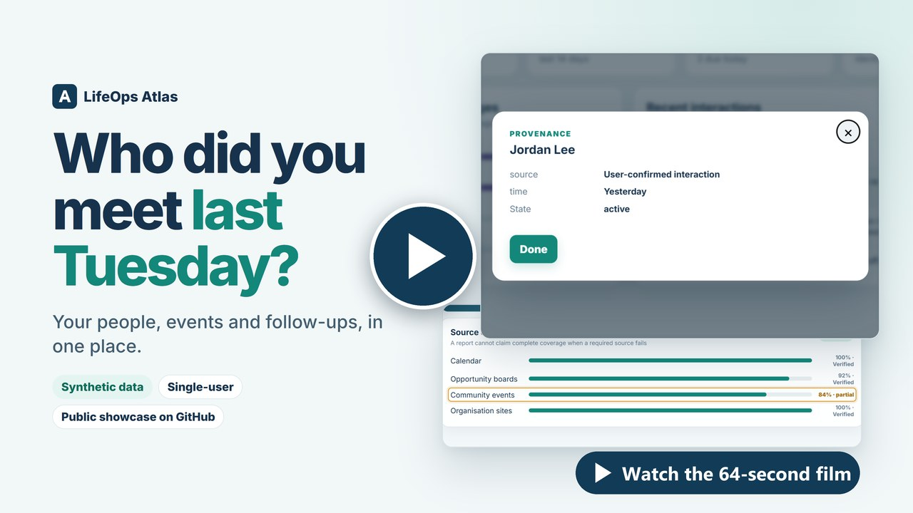
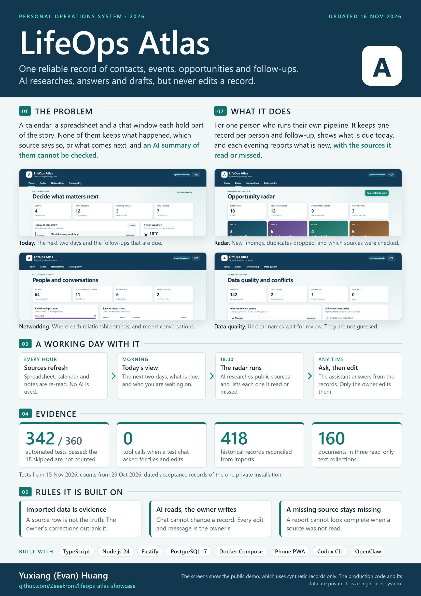
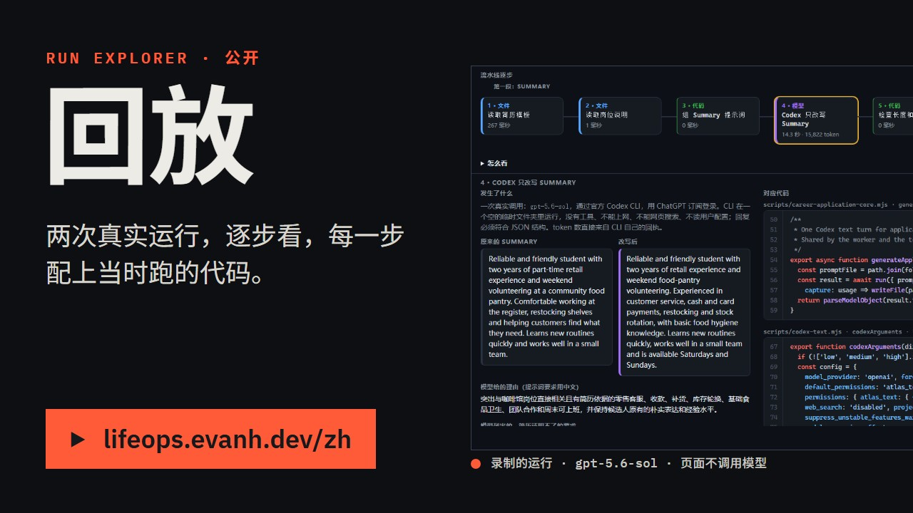
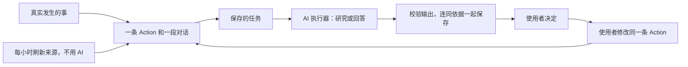
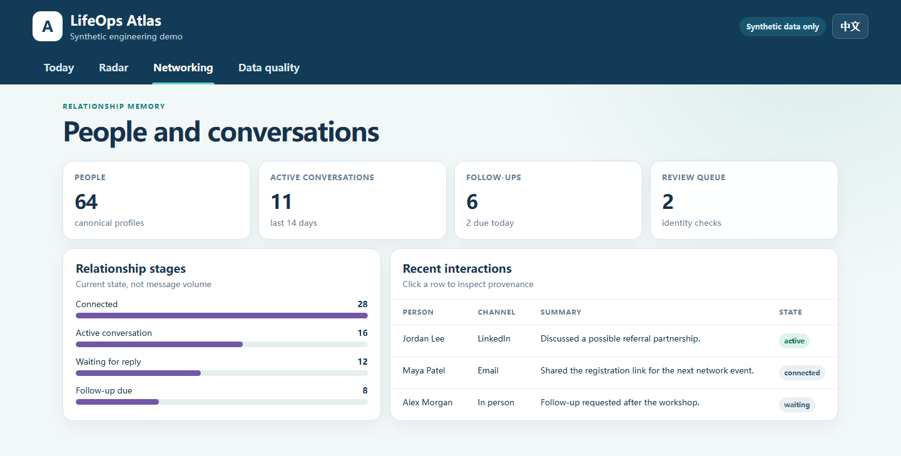
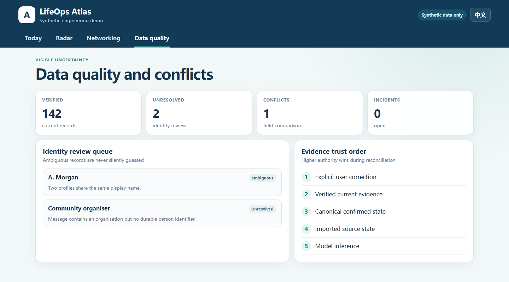
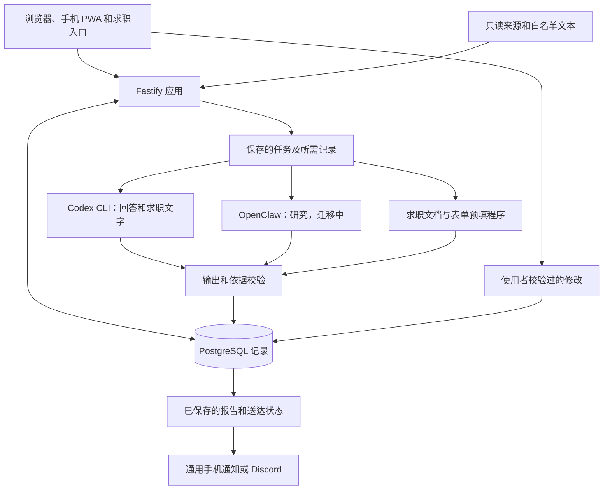

# LifeOps Atlas

<p><a href="README.md">English</a> · <strong>简体中文</strong></p>

[](https://github.com/Zeeekrom/lifeops-atlas-showcase/actions/workflows/validate.yml)


LifeOps Atlas 把一个人的日程、联系人、跟进事项、机会和研究资料存成一份可靠的记录，并说明每条信息从哪里来。使用者用它安排每天的事、跟进联系过的人、留意活动和机会，以及准备求职申请。

它用 AI 协助，但由程序把关。AI 负责研究公开来源、根据记录回答问题、起草求职文字；保存什么由程序决定：AI 的输出要先通过校验才会保存，聊天不能修改记录，每一条消息、每一份申请都由使用者自己发出。

这是一个个人使用的单用户系统，在本机运行一套实例。它不是产品，不是云服务，也不是给团队用的 CRM。

应用源码、真实记录、提示词和配置都在私有仓库里。本仓库是经过筛选的作品集展示版，只放文档、注明日期的结果、合成数据演示和合成数据截图，不公开任何个人数据。

<table>
<tr>
<td><a href="https://zeeekrom.github.io/lifeops-atlas-showcase/video/"></a></td>
<td><a href="media/poster.jpg"></a></td>
</tr>
<tr>
<td align="center"><a href="https://zeeekrom.github.io/lifeops-atlas-showcase/video/">64 秒短片，2026 年 10 月</a></td>
<td align="center"><a href="media/poster.jpg">海报，2026 年 11 月 16 日</a></td>
</tr>
</table>

<table>
<tr>
<td><a href="https://lifeops.evanh.dev/zh/"></a></td>
</tr>
<tr>
<td align="center"><a href="https://lifeops.evanh.dev/zh/">回放：两次真实运行的录制，所有人可看</a></td>
</tr>
</table>

**合成数据演示（示例数据、预设回答）：**[打开四个页面的演示](https://zeeekrom.github.io/lifeops-atlas-showcase/)
——今日、雷达、人脉和数据质量，里面全是编出来的记录。它在浏览器里运行，没有后台、没有账号，也不调用 AI。

**短片：**[观看 64 秒短片](https://zeeekrom.github.io/lifeops-atlas-showcase/video/)
——合成数据页面的导览。短片录于 2026 年 10 月，里面的页面和数字都是当时的。

**互动演示：**[Run Explorer 运行回放](https://lifeops.evanh.dev/zh/)（[English](https://lifeops.evanh.dev/)）
——求职材料流水线的每一步：它处理了什么数据，以及当时运行的私有实现代码片段（提交 `6bd7f5c`）。
回放里是 2026 年 11 月 21 日录下的两次运行，每次都通过官方 Codex CLI 真实调用了两次 gpt-5.6-sol；页面本身不调用模型。
候选人、雇主和申请表都是虚构的。


合成数据的雷达页面。一次研究运行会显示找到了什么、去掉了多少重复项、检查了哪些来源（这里 12 个成功了 11 个），以及哪些还在等复核。需要复核的发现不会自动写进记录；有必需来源失败时，报告不能显示为覆盖完整。页面上所有数字都是编的。

## 目录

- [项目概况](#项目概况)
- [要解决的问题](#要解决的问题)
- [给谁用](#给谁用)
- [一条跟进从头到尾](#一条跟进从头到尾)
- [系统界面](#系统界面)
- [AI 智能体在什么位置](#ai-智能体在什么位置)
- [目前能做什么](#目前能做什么)
- [设计原则](#设计原则)
- [真实记录与合成数据](#真实记录与合成数据)
- [开发过程](#开发过程)
- [从问题变成的规则](#从问题变成的规则)
- [技术栈](#技术栈)
- [验收证据](#验收证据)
- [运行公开演示](#运行公开演示)
- [安全与数据边界](#安全与数据边界)
- [尚未完成的部分](#尚未完成的部分)
- [项目的收获](#项目的收获)
- [公开版与私有版边界](#公开版与私有版边界)
- [版权与条款](#版权与条款)

## 项目概况

| | |
|---|---|
| 这是什么 | 个人运营系统：日程、跟进、人脉、研究和求职准备放在同一个数据库里；AI 只读取和起草，不做决定 |
| 给谁用 | 自己管理联系人、活动、机会和求职申请的一个人。这个公开版是给软件、数据和应用支持方向的评审者看的 |
| 要解决的问题 | 日历、表格和聊天窗口各记了一部分。没有一个能同时留下“发生了什么、依据在哪里、下一步做什么”，而 AI 根据它们写的摘要也没法核对 |
| AI | 每晚的研究运行，报告发现并列出读过的来源；根据记录给出只读回答；根据使用者自己的材料起草求职文字。从 2026 年 11 月 15 日起，聊天和求职文字改用官方 Codex CLI，以隔离的纯文字模式运行；研究和 Discord 发送仍在 OpenClaw 上，迁移还没做完 |
| 技术栈 | TypeScript、Node.js 24、Fastify 5、Zod、PostgreSQL 17、Docker Compose、原生 HTML/CSS/JavaScript 和手机 PWA |
| 证据 | 2026 年 11 月 15 日：360 项测试中 342 项通过、18 项条件跳过；受限 AI 的诱饵测试没有发生任何工具调用；一次真实聊天完整走通队列。2026 年 10 月 29 日：418 条历史记录完成对账，27 项隔离 PostgreSQL 检查全部通过 |
| 数据 | 真实记录只在私有实例里。本仓库只有合成数据截图、合成数据演示，以及一份格式固定、注明日期的计数文件 |
| 状态 | 本机一套实例，由使用者自己在用；影子对比从 2026 年 9 月 16 日开始。不是多用户产品，也没有部署到云上。[互动演示](https://lifeops.evanh.dev/zh/)（2026 年 11 月）用虚构数据回放求职流水线的真实运行 |

## 要解决的问题

自己管理一条求职或业务线，每天都要回答同样几个问题，而大多数工具只能回答其中一部分：

- 今天该做什么？我在等谁回复？
- 上次和这个人聊是什么时候？我答应过要做什么？
- 最新一次导入，是不是把我手动改过的内容又盖掉了？
- 今晚的研究完整吗？有没有来源读取失败？
- 哪句话是我说的，哪句是活动上演讲者说的，哪句来自新闻？
- AI 能不能根据我的记录回答问题，同时又没有权限改记录？

LifeOps Atlas 用同一个数据库回答这些问题，并把每条信息的来源存在旁边。

## 给谁用

LifeOps Atlas 服务于自己管理一条线的一个人：比如在找工作的人、在新城市建立人脉的人，或者独立工作的人。下表是它在每个环节回答的问题。

| 场景 | 要回答的问题 | Atlas 给出的内容 |
|---|---|---|
| 安排今天 | 今天该做什么？在等谁？ | 今日日程和未完成的 Action（跟进事项），每条按自己的等待规则计时 |
| 跟进一个人 | 上次聊是什么时候？下一步是什么？ | 每个跟进对应一条 Action 和一段对话，状态怎么变都还是同一条 |
| 留意机会 | 今晚有什么新的？实际读了哪些来源？ | 雷达报告：发现、去掉的重复项和每个来源的覆盖情况 |
| 准备申请 | 能不能改简历又不动原件？ | 根据使用者自己的材料起草一份单独的 Summary 副本；申请由本人提交 |
| 核对数据 | 哪些记录对不上？为什么？ | 身份复核队列，以及固定的“哪种依据优先”的顺序 |

实际运行的实例只服务于使用者本人。给小团队等更多人使用是一个可能的方向，还没有做，也没有测试过。

## 一条跟进从头到尾

下面是示意，不含任何真实联系人或消息。



1. **真实的事发生了。** 使用者记下自己发出的一封邮件，关联到一个人和一条 Action。
2. **设好复查点。** 邮件跟进默认等七个自然日。没回复的领英消息有单独的规则，不会自动倒计时、显示逾期。
3. **刷新来源。** 一个协调器每小时重新读取允许的来源并对账，不调用 AI 模型。
4. **AI 工作作为保存好的任务运行。** 调用模型之前，任务连同它需要的记录先保存下来。研究运行会记下读过哪些来源；回答只用交给它的那些记录。
5. **校验并保存结果。** 输出先校验，再连同依据一起保存。“报告已保存”和“通知已送达”分开记录。
6. **由使用者决定。** 聊天给出解释或草稿。使用者在管理表单里修改这条 Action，消息和申请都由本人发出。下一阶段继续用同一条 Action 和同一段对话。

## 系统界面

| | |
|---|---|
|  |  |
| **今日。** 接下来两天的安排和到期的 Action | **人脉。** 每段关系进行到哪一步，以及最近的互动 |
|  |  |
| **雷达。** 发现、去掉的重复项和检查过的来源 | **数据质量。** 认不准的身份等人复核，不靠猜 |

这四个页面来自合成数据演示，展示的是部分设计，不是个人记录的截图，也不包含私有系统的全部功能。

## AI 智能体在什么位置

AI 层由一个研究流程和两个范围更窄的文字执行器组成。它们共用 Atlas 的记录和任务队列，各自的边界不同。

| 角色 | 做什么 | 结果由什么把关 |
|---|---|---|
| 研究智能体 | 每晚研究允许的公开来源，写出带发现和来源覆盖情况的雷达章节 | 保存的任务、规定的输出格式、身份匹配、有上限的重试和明确标出的缺口 |
| 回答执行器 | 解释交给它的记录、对话和文本片段 | 聊天只读，模型文字不能修改记录 |
| 求职文字执行器 | 根据使用者自己的材料改写简历 Summary、起草普通申请问题的答案 | 来源事实、长度检查、受保护的模板和单独的申请程序 |
| 来源读取器 | 刷新选定的本地文本和已连接的来源 | 只读的允许文件清单或批准过的连接器操作；连上了不等于读取成功 |
| 应用协调器 | 安排工作、领取任务、校验结果、保存状态 | 普通程序代码、数据库约束和带审计的管理表单 |



**11 月 15 日只完成了一部分迁移。** 聊天和求职文字现在调用官方 Codex CLI，使用使用者已有的 ChatGPT 登录。每次调用都在一个新的临时文件夹里运行，文件和网络权限受限，命令工具、网页搜索、应用和插件都关闭。调用失败时不会改走付费 API 或 OpenClaw。雷达研究和 Discord 发送仍依赖 OpenClaw。

求职表单预填是一个单独的程序，不是由文字模型操控的浏览器。敏感问题和最终提交都由本人完成。把上下文交给 ChatGPT 是明确的复制粘贴，不会搜索使用者的 ChatGPT 历史。

[智能体分工、控制与验收说明](docs/ai-agents.md#中文说明)

## 目前能做什么

| 功能 | 已经实现的内容 |
|---|---|
| 今日与跟进 | 日程、本地活动、可归档可重开的稳定 Action，各阶段复用同一段对话 |
| 跟进计时 | 日期从确认过的事实算起（已发出、已收到、已参加）；按本地自然日；手动设的日期受保护；每种渠道有自己的等待规则 |
| 人脉 | 人物、机构、互动，以及带依据的身份复核决定 |
| 助手 | 七个保存的助手空间、报告历史、带引用的文本检索，以及复制粘贴给 ChatGPT 的交接 |
| 每日雷达 | 报告分四个部分，通常在霍巴特时间晚上 6 点运行；排队、领取、有上限的重试、每个来源的状态和送达记录 |
| AI 技术雷达 | 固定抽样的公开 API 和信息流，相关性说明附上所用的依据 |
| 知识与文件 | 三个只读的白名单文本集合（2026 年 10 月 29 日共 160 篇），保留来源指纹；上传的原件单独存放 |
| 求职准备 | 本地非 IT 岗位的 SEEK 试点：保存职位描述、Summary 副本、DOCX/PDF 输出和普通表单预填。从不修改原始模板 |
| IT 支持 | 工单、优先级和服务目标、资产、证据、知识文章和 Bug Log |
| 手机与通知 | 手机 PWA 和 Web Push；通知预览只有固定的通用文字，详情要连上私有网络才能打开 |
| 运维 | 两个容器（应用和 PostgreSQL）、主机执行器，以及只监听本机回环地址、只执行白名单操作的恢复控制器 |

[完整功能地图](docs/feature-map.md) · [工程决策](docs/engineering-decisions.md)

## 设计原则

- **记忆放在数据库里，不放在提示词里。** 当前事实存在 PostgreSQL 里，有约束、有历史。提示词只管行为和输出格式。
- **导入的一行是证据，不是事实。** 使用者的修正单独保存，下一次导入不会把它盖掉。
- **AI 只读取和起草，不改记录。** 聊天只读，修改要走校验过的管理表单。
- **先保存任务，再调用模型。** 额度用完、登录失效、网络断开都是常态，调用失败后留下的是保存好的请求，不会丢。
- **缺的来源就标为缺。** 只覆盖了一部分就报告“部分覆盖”；连上的来源要等真正读到了才算读过。
- **不同种类的证据分开放。** 本人的经历、演讲者的说法、关于别人的报告、技术新闻，是不同的来源类型。新闻永远不会变成个人技能。
- **由本人发出。** 消息、申请和最终提交都是手动的。
- **通知不透露隐私。** 手机通知预览只有固定的通用文字。
- **领英只能手动。** 无论登录与否，任何自动化都不碰领英。

来源之间说法不一致时，按这个顺序取舍：使用者明确的确认或修正，然后是核实过的当前证据、已确认的记录、导入的来源行、提示词默认值，模型推断排最后。

## 真实记录与合成数据

| 数据 | 是什么 | 在哪里 |
|---|---|---|
| 私人记录 | 人物、机构、互动、活动、机会、Action 和报告 | 只在私有实例里 |
| 知识集合 | 三个只读集合里的 160 篇白名单文本（2026 年 10 月 29 日） | 私有；只公开数量 |
| 运行快照 | 2026 年 10 月 29 日验收记录里的计数和日期，格式固定，放不进名字或文字 | [`docs/operating-snapshot.json`](docs/operating-snapshot.json) |
| 演示记录 | 给四个页面编的人物、活动、发现和复核 | [`demo/data.json`](demo/data.json) |
| 截图、短片和海报 | 从合成数据演示截取 | [`media`](media)、短片页面 |

合成数据只用来展示页面怎么用，不代表使用者的人脉、活动或成果。

## 开发过程

| 日期 | 变化 |
|---|---|
| 2026 年 9 月 16 日 | 第一套本机实例；开始影子对比 |
| 2026 年 10 月 9 日 | 公开展示仓库和四个页面的合成数据演示上线 |
| 2026 年 10 月 29 日 | 验收记录：160 篇文本建立索引，418 条历史记录完成对账，295 项测试中 288 项通过，27 项隔离 PostgreSQL 检查全部通过。功能地图公开了手机 PWA、求职试点、IT 支持工单和只读知识库 |
| 2026 年 11 月 7 日 | 合成数据演示的 64 秒短片 |
| 2026 年 11 月 13 日 | 公开网站加上中英两版的版权条款、隐私说明和爬虫规则 |
| 2026 年 11 月 15 日 | 聊天和求职文字改用官方 Codex CLI，以隔离的纯文字模式运行；360 项测试中 342 项通过、18 项跳过 |
| 2026 年 11 月 21 日 | 互动演示 Run Explorer 在 lifeops.evanh.dev 上线：求职材料流水线在虚构候选人上的两次真实运行录制，每一步都链接到当时运行的代码 |

10 月 29 日和 11 月 15 日两次验收记录的说明见[验证定义](docs/verification.md)。

## 从问题变成的规则

| 出过的问题 | 改成了什么 |
|---|---|
| 后来的导入可能把手动修正盖掉 | 来源版本和修正分开保存，每次导入都重放优先级更高的修正 |
| 重新打开同一条 Action，历史容易散到好几段对话里 | 每条 Action 不论状态怎么变，都只用一段对话 |
| 排队中的雷达任务看起来像在运行 | 排队、执行器领取、报告已保存、消息已送达分成不同状态，失败和重试都显示出来 |
| AI 生成的修改建议不是可靠的改记录方式 | 停用可执行的聊天卡片，改走校验过的管理表单 |
| 手机还没连上私有网络时，通知可能露出隐私内容 | 通知只有固定的通用文字，详情在 Atlas 里打开 |
| 服务商或程序版本可能突然不能用 | 保留已保存的请求，给失败分类；要不要换备用方案写在策略里，不自动切换 |

## 技术栈

- TypeScript、Node.js 24、Fastify 5 和 Zod 数据协议
- PostgreSQL 17：约束、来源指纹、文本分块和词项排序（没有单独的向量数据库）
- 原生 HTML、CSS 和 JavaScript；中英文界面；带 Web Push 的手机 PWA
- 官方 Codex CLI 处理文字；剩下的研究和发送链路用 OpenClaw
- 求职试点复用部分 Career Ops 模块、Chromium 自动化和 Python 文档处理
- Docker Compose、主机执行器、只监听本机回环地址的恢复控制器，以及可选的私有网络（Tailscale）
- 自动化测试、隔离 PostgreSQL 检查、公开数据校验和注明日期的验收记录

组件和数据流见[架构说明](docs/architecture.md)，取舍见[工程决策](docs/engineering-decisions.md)。

## 验收证据

每一项都是私有实例上注明日期的验收观察。运行过程和复现代码留在私有仓库里，这里只公布结果。

- **2026 年 11 月 15 日，文字迁移：** 一次真实聊天走完 API、队列、Codex 执行器和数据库；保存的回答和用量记录都标明是 Codex
- **2026 年 11 月 15 日，文字边界：** 一次合成的对抗聊天要求读取工作区外的文件、修改记录和上网。诱饵值没有泄露，记录没有变化，没有访问链接，也没有发生任何工具调用
- **2026 年 11 月 15 日，求职起草：** 实际使用的 Summary 生成器写出了有依据的合成草稿，没有改动源简历，也没有提交申请
- **2026 年 11 月 15 日，自动化测试：** 360 项中 342 项通过、18 项条件跳过；另有 5 项隔离 PostgreSQL 检查（用量记录和只读聊天）通过，单独统计
- **2026 年 10 月 29 日，运行快照：** 见下文

条件跳过不算通过。这些是具体检查的结果，不是全面安全审计，也不承诺今后一直在线。[验证定义](docs/verification.md)

### 注明日期的运行与验收快照

运行基线的日期是 **2026 年 10 月 29 日**。公开仓库**不会实时连接私人生产数据库**。

<table>
<tr>
<td align="center"><strong>160</strong><br><sub>白名单文本数量</sub></td>
<td align="center"><strong>418</strong><br><sub>已对账的历史来源记录</sub></td>
<td align="center"><strong>288 / 295</strong><br><sub>主测试通过／总数；7 项跳过</sub></td>
<td align="center"><strong>27 / 27</strong><br><sub>另一组 PostgreSQL 检查通过</sub></td>
</tr>
</table>

418 条记录里，264 条与已有记录匹配，新增 153 条，1 条只做归档。快照还记录了三个集合、影子对比开始后的 43 个自然日，以及一次用 22 项依据生成三条建议的样例。自然日跨度不是在线时长，导入数量不是发出的消息数，建议数量也不是求职结果。[可机读的快照](docs/operating-snapshot.json)

## 运行公开演示

```bash
npm run validate:public
npm test
npm run dev
```

打开 <http://127.0.0.1:4173>。静态演示只用本地合成数据，没有生产后台，也不连接任何账号。

不想运行也能看求职流水线怎么工作：打开 [Run Explorer 运行回放](https://lifeops.evanh.dev/zh/)。

## 安全与数据边界

- 公开演示没有后台、没有凭据，也不调用 AI，连不到私有实例。
- Codex 调用逐次受限：新的临时文件夹、不能随意访问文件、命令不能联网，命令工具、网页搜索、应用、插件和记忆功能都关闭。这些设置减少了单次调用能做的事，但不是完整的安全评估，也没有测试过 CLI 今后的变化。
- 聊天不能修改记录、执行 Action 或发送消息。使用者的修改走管理表单和带审计的记录管理器，并检查身份和版本；导入只写来源证据，不会覆盖修正。
- 恢复控制器只监听本机回环地址，只执行固定的操作清单。
- 手机通知预览只有固定的通用文字，打开详情需要私有网络。
- 公开来源读取器不绕过登录、robots 规则或人机验证。整个项目对领英只允许手动操作。
- 系统为一个人设计，不支持多用户访问，也不是多租户。

## 尚未完成的部分

- 把剩下的研究和 Discord 链路迁出 OpenClaw，然后停用它。
- 决定并测试云端部署（AWS 或 Azure），目前实际运行的实例仍在本机。
- 恢复相关工作后，完成第二台设备上的验收。
- 完成求职试点中登录后真实申请表的验收；提交仍由人工完成。
- 先让其他用户试用并衡量效果，再说能不能扩大使用范围。

## 项目的收获

- 一份能修正的记录，比一段没法核对的摘要更有用。
- 先保存任务再调用模型，AI 失败时留下的是排队中的请求，而不是丢失的工作。
- 报告里写明哪些来源失败了，一份看起来很有把握的报告才算诚实。
- 让 AI 不碰写入路径，换服务商就是安全的：迁到 Codex 只换了一个执行器，记录没有受影响。
- 把“我做过的”和“我读到的”分开，新闻就不会变成简历上的能力。

## 公开版与私有版边界

本仓库与私有实现**没有共享 Git 历史**，只放审核过的说明、合成示例和选定的注明日期计数。个人记录、通信内容、简历、来源路径、凭据、生产提示词和运行日志都不会放进来。

唯一展示实现代码的地方是 [Run Explorer 运行回放](https://lifeops.evanh.dev/zh/)：只针对求职材料这一条流水线，显示每一步运行的函数和它们拼出的提示词，以片段形式固定在私有实现的某一个提交上，运行用的是虚构数据。其余源码仍然是私有的。

演示、短片和海报各有自己的日期和范围，不能据此推断云端部署、录用结果、节省的时间或完整的来源覆盖。[公开边界说明](docs/publication-boundary.md)

## 版权与条款

© 2026 LifeOps Atlas，保留所有权利，见 [LICENSE](LICENSE)。未经书面许可，不得复制、转载或改编本仓库的任何内容，也不得用手工、自动化工具或 AI 克隆工具重建项目的代码和设计；除法律允许的情形外，不得对代码进行逆向工程；不得抓取、批量下载这些内容，或把它们用于训练、评测 AI 模型。法律本身允许的使用（如为评论、新闻报道合理引用）不受影响。欢迎分享链接。法律允许的例外、GitHub 平台本身的权限和第三方许可仍然适用，见[第三方声明](THIRD_PARTY_NOTICES.md)。条款、许可与隐私见[条款页](https://zeeekrom.github.io/lifeops-atlas-showcase/terms/?lang=zh)。
