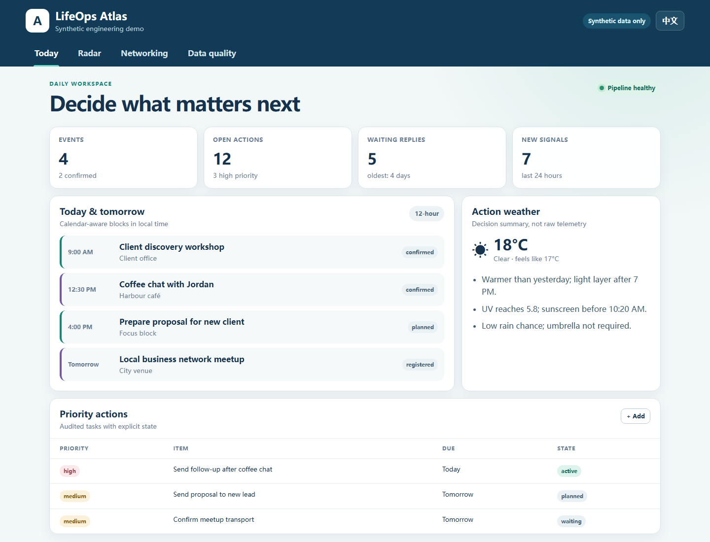
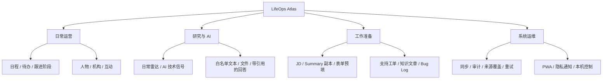
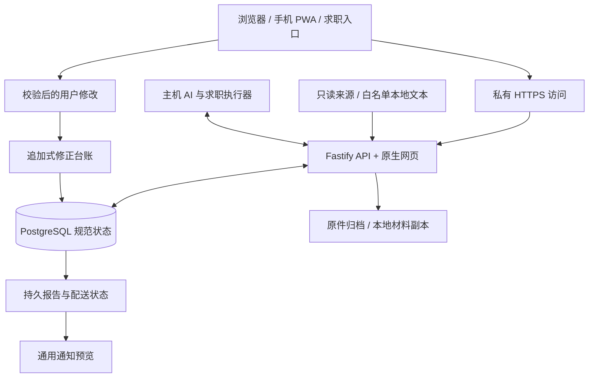
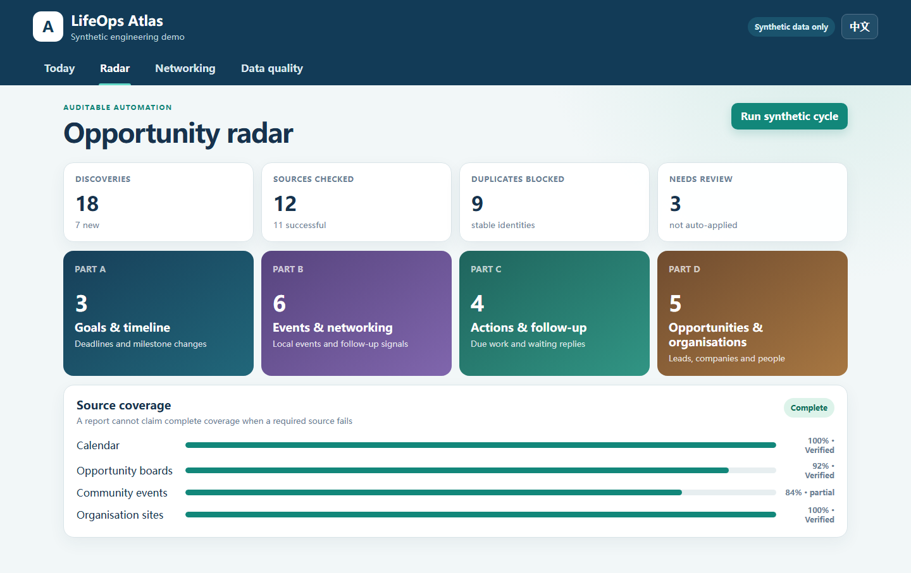
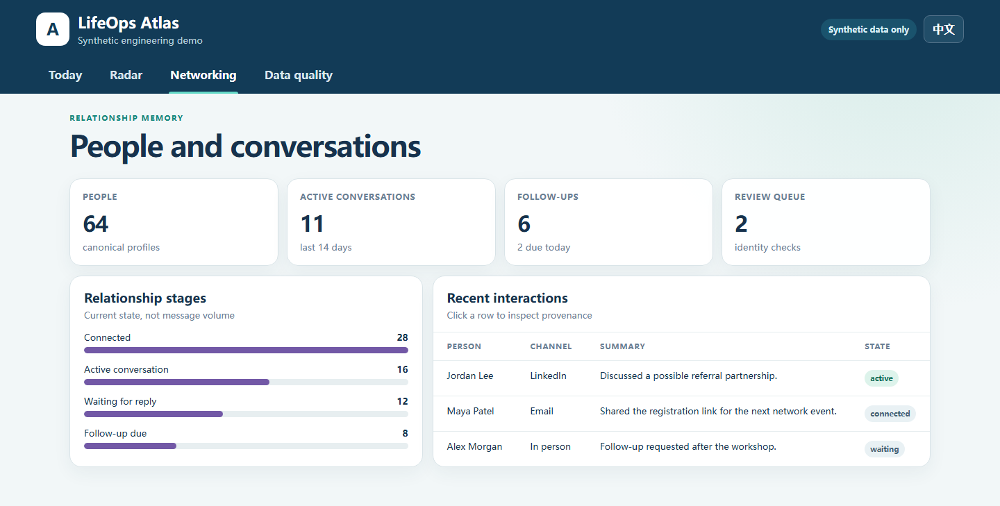
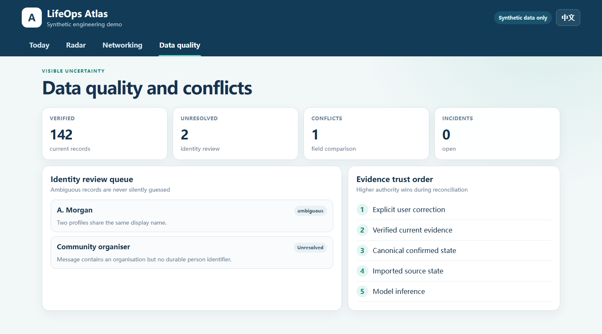
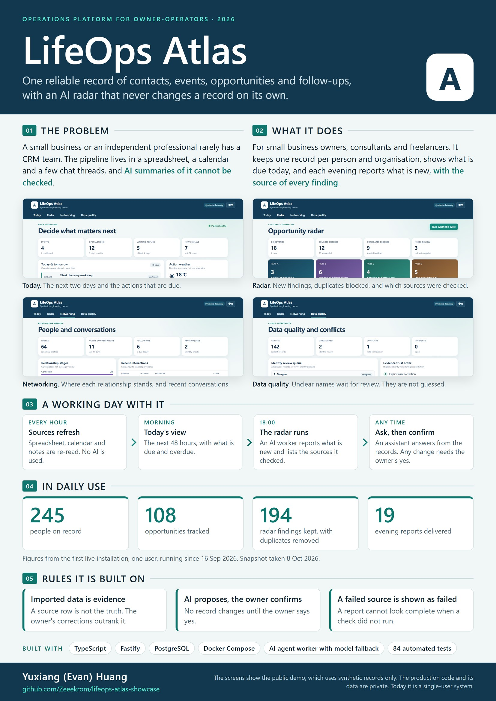

# LifeOps Atlas

<p align="right"><a href="README.md">English</a> · <strong>简体中文</strong></p>

> 一个单用户个人运营系统，把待办、人物关系、活动研究和求职准备放进同一套有来源依据的工作台。
> 持久状态存在 PostgreSQL；AI 读取有边界、可追溯的资料。

[](https://github.com/Zeeekrom/lifeops-atlas-showcase/actions/workflows/validate.yml)




**[打开合成数据演示](https://zeeekrom.github.io/lifeops-atlas-showcase/)**

这里是经过筛选的作品集版本：静态演示、工程图和注明日期的汇总数字。
不包含个人记录、生产提示词、账号标识和私有配置。所有产品截图均来自合成数据；
真实数据和生产代码保留在私有仓库。

## 项目概况

| 方面 | 当前范围 |
| --- | --- |
| 问题 | 表格、日历和聊天输出不一致；跟进过程丢失上下文；AI 摘要隐藏来源缺口 |
| 做法 | 单一规范数据库、追加式修正、来源证据与持久化后台任务 |
| 生产技术栈 | Node.js 24、TypeScript、Fastify 5、Zod、PostgreSQL 17、Docker Compose |
| 界面 | 原生 HTML/CSS/JavaScript、双语网页、手机 PWA、共用后台的求职入口 |
| AI 执行 | 主机执行器读取有界快照，结果需校验，服务商失败有明确状态 |
| 部署范围 | 一套本地单用户影子系统；不是多租户 SaaS，也不声称持续在线 |
| 公开版本 | 四个合成数据页面、架构说明、功能边界与汇总验收快照 |

## 系统板块



[功能地图与边界](docs/feature-map.md) · [架构](docs/architecture.md) ·
[工程决策](docs/engineering-decisions.md)

| 私有系统已实现 | 可以展示的工程能力 | 实际限制 |
| --- | --- | --- |
| 每日工作台与 Action 生命周期 | 稳定 ID、归档/重开、本地时间检查点、修正重放 | 阶段必须有确认事实；没记录不等于对方没回复 |
| 研究雷达 | 持久任务、来源审计、有上限重试、先保存报告再配送 | 被阻断或未核查来源仍是部分覆盖/未知 |
| AI 技术雷达 | 固定 API/feed 样本、不可变来源快照、带证据的个人相关性 | 不是完整趋势榜；新闻不能当成用户的技能或业绩 |
| 文本知识与文件分析 | 只读清单、内容指纹、限定检索、原件保留 | 不自动读取整个硬盘；文本提取可能失败 |
| 七个助手空间 | 持久历史、Action 对话复用、明确的 ChatGPT 复制粘贴交接 | 当前聊天只读；改记录通过管理页面 |
| 求职准备试点 | 保存 JD、不改模板的 Summary 副本、文档输出、普通字段预填 | 本地非 IT 岗位试运行；最终提交由人工完成 |
| 应用支持 | 工单、优先级、服务目标、证据、知识文章、修复历史 | 不是完整企业端点管理；第二台设备的接入未完成实机验收 |
| 手机与通知 | PWA 订阅、通用预览、私有网络内打开详情 | 不是原生手机应用；主机仍需运行 |

领英始终由用户手动访问。允许分析已有离线资料和用户提供的文字，
但本项目不会自动访问、搜索或抓取领英，也没有切换账号等绕行机制。

## 注明日期的运行与验收快照

以下为私有验收记录中 **2026 年 10 月 29 日** 的选定汇总。
公开仓库**不会实时连接私人生产数据库**。

<table>
  <tr>
    <td align="center"><strong>43 天</strong><br><sub>距影子对比开始的自然日</sub></td>
    <td align="center"><strong>160</strong><br><sub>已建立索引的白名单文本</sub></td>
    <td align="center"><strong>3</strong><br><sub>只读文本集合</sub></td>
    <td align="center"><strong>418</strong><br><sub>已对账的历史源记录</sub></td>
  </tr>
  <tr>
    <td align="center"><strong>288 / 295</strong><br><sub>主测试通过/总数；另有 7 项条件跳过</sub></td>
    <td align="center"><strong>27 / 27</strong><br><sub>独立 PostgreSQL 验收测试通过</sub></td>
    <td align="center"><strong>3</strong><br><sub>一次验收样例中的个人相关性建议</sub></td>
    <td align="center"><strong>22</strong><br><sub>该样例冻结的依据条目</sub></td>
  </tr>
</table>

- 43 天指 2026-09-16 至 2026-10-29 的自然日跨度，**不是连续在线时长、实际使用小时数或可用率**。
- 历史导入的 418 条源记录中，264 条匹配已有报告，153 条补为消息，1 条无可导入文字而仅归档。
  重复执行不会重复插入。这是导入规模，不是发送量。
- 27 项真实数据库测试在独立测试库单独执行。主测试中的 7 项条件跳过没有被算作通过。
- 建议样例保留对应输入依据；这不是每日产出率，也不是个人技能证明或求职效果指标。

[可读取的汇总快照](docs/operating-snapshot.json) ·
[指标定义与验收限制](docs/verification.md)

旧版业务记录数量没有被重新标成当前数据。下面的海报保留其原始十月快照，属于历史材料。

## 技术架构与数据归属



网页服务和数据库是两个容器。AI 执行器、浏览器预填和本机启动控制器运行在主机上。
主应用停止时，由独立控制器恢复。手机、求职入口与主网页共用数据，不各存一份互相冲突的数据库。

导入的表格行是来源证据。用户确认的修改单独保存，后续导入后重放；
日历删除保留标记。跟进阶段沿用同一个 Action 身份，不删除重建。
当前文本检索使用 PostgreSQL 分块和词项排序，没有独立向量数据库。

## 哪里使用 AI

AI 用于雷达分析、带引用的对话回答、有界的个人相关性建议，以及定制 Summary 草稿。
调度、普通同步、去重、状态变更和页面统计使用确定性代码。

模型回答不能凭空宣称完成了外部操作，也不能覆盖记录。聊天目前只读，
管理页面通过带审计的管理器修改数据。ChatGPT 交接只复制上下文，用户自行粘贴发送；返回文字仍是外部证据。

来源缺口、服务商失败、依据不足和文本提取失败都会保留。
通知预览采用通用文字，不附姓名、待办、数量或报告内容；详情需要私有访问。

## 合成数据演示

| | |
| --- | --- |
|  |  |
| 今日：日程、待办、天气 | 雷达：合成发现与来源覆盖 |
|  |  |
| 人脉：关系阶段与来源 | 数据质量：身份复核与证据权威 |

这四个页面演示选定的设计模式，不包含上面列出的全部私有功能。
Demo 里的姓名、岗位和数字是合成数据，与注明日期的真实汇总分开。

```bash
npm run validate:public
npm test
npm run dev
```

打开 <http://127.0.0.1:4173>。静态演示没有生产后台，不连接真实账号；演示数据从本地加载。

## 当前限制

- 单用户、依赖主机的影子部署；没有多租户权限模型，也不声称云端可用率。
- 只读权限不代表每轮都读到了全部已连接来源；来源核查有范围上限，可能部分完成。
- 不自动投递、联系他人、报名，也不做领英自动化。
- 未完成企业端点全面部署、原生 Android 应用，以及把原始录音自动写成已认可个人成果的流程。
- 未发布转化、录用或节省时间的结果；这里只证明运行规模和具体的验收记录。

## 历史海报



海报使用 **2026 年 10 月 8 日** 的运行快照。其数量与早期功能描述作为历史保留，
当前能力以上面的功能表和注明日期的快照为准。

## 公开版与私有版边界

公开仓库不与生产仓库共享 Git 历史，也不是自动镜像。
通用工程描述、选定汇总数字和合成示例在发布前单独复核。
个人记录、简历、沟通内容、来源路径、生产提示词、账号标识和运行材料均不公开。

[发布边界](docs/publication-boundary.md) 规定发布检查。
自动校验辅助人工复核，不能声称自动识别所有可能的敏感文字。

目前不授予复用许可；公开仅用于技术评审和作品集评估。
