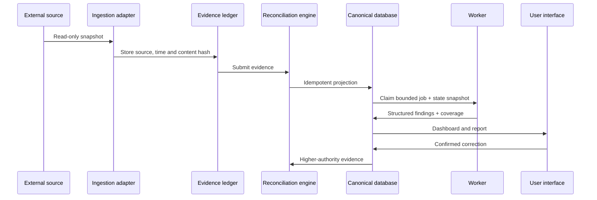

# Architecture

## Design goal

LifeOps Atlas converts unreliable conversational and spreadsheet state into a
system that can explain what it knows, where each fact came from, why a decision
was made and what failed during an automated run.

## Data flow

The current production web interface is native HTML/CSS/JavaScript served by
Fastify on Node.js 24. PostgreSQL 17 is a second Docker service. Phone PWA and
the focused Jobs entry share that backend. AI workers, browser prefill and a
loopback-only bootstrap controller run separately on the host. The synthetic
public application has no access to any of these private services.

## Core components

### Source adapters

Adapters read spreadsheets, calendars, public web sources and uploaded files.
They never write directly to canonical business tables. Every ingestion keeps
the provider, observation time, source identity and content hash.

### Evidence and reconciliation

The evidence ledger allows conflicting statements to coexist until policy can
resolve them. A newer explicit correction can outrank an older imported row;
absence from a source never automatically proves that an interaction or event
did not happen.

### Canonical state

The canonical model covers people, organisations, interactions, events,
opportunities, actions, rules and incidents. Deterministic identifiers and
idempotent projections make repeated imports safe.

### Radar jobs

The scheduler creates a durable job before invoking an AI worker. The worker
receives a bounded state snapshot and must return structured discoveries,
source coverage and report sections. Failures remain visible with categories
such as provider quota, authentication, contract validation and stale schedule
window.

### Conversation worker

User messages are committed before model invocation. If the provider is
unavailable, the request remains saved for queue/retry handling. Free-form model
text cannot mutate canonical records. Current chat is read-only; the manual
management screens apply validated changes through audited record managers.

### Text knowledge and files

Three local text collections publish manifests for read-only incremental
ingestion. Documents retain source versions and hashes. Retrieval uses
PostgreSQL text chunks and lexical ranking rather than a separate vector store.
Personal facts, meeting material, reports about other people and technology
news remain distinct evidence types.

Uploaded originals are archived separately. Extracted attachment text belongs
to file records alongside the knowledge index; a stored file is not necessarily
successfully extracted or automatically indexed. Recommendations preserve
their frozen evidence set instead of changing when a source is later edited.

### Preparation and support

The career pilot captures descriptions, prepares separate resume Summary
copies and prefills ordinary application fields; final submission is manual.
Application support includes cases, evidence, service targets, articles and
Bug Log entries, without claiming a completed enterprise endpoint deployment.

### Delivery privacy and cadence

Ordinary synchronization uses one hourly coordinator and no AI call. The daily
Radar reuses sufficiently fresh source results or waits for synchronization
before AI work. Source coverage, report persistence and message delivery have
separate states. Fixed generic notification previews contain no private task
or report content; following the link requires private-network access.

All LinkedIn access is manual-only. Public-source adapters do not bypass login,
robots restrictions or challenges. A connected source that was not successfully
read remains a coverage gap, not verified coverage.

## Trust order

1. Explicit user confirmation or correction.
2. Verified current evidence.
3. Confirmed canonical state.
4. Imported source state.
5. Prompt defaults.
6. Model inference.

This order prevents a stale source row or confident model answer from silently
overwriting a known real-world update.
