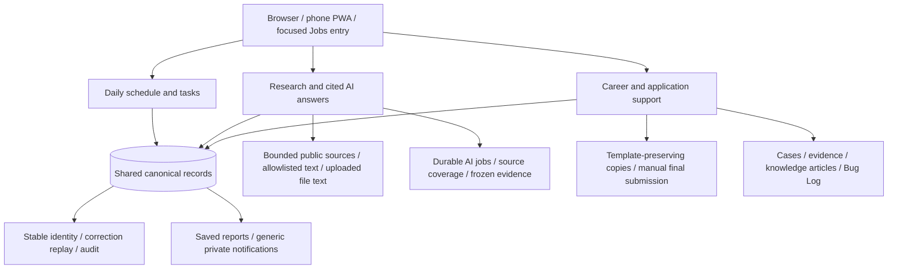

# Capability map / 功能地图

Reviewed 29 Oct 2026. These are implemented private-system capabilities,
not a live-service availability report. The public demo remains a four-screen
synthetic walkthrough.

| Block | Current behaviour | Deliberately not claimed |
| --- | --- | --- |
| Today and tasks | Local schedule editing, due-work review, archived work recovery, same-record follow-up stages | Inferring that a meeting happened from a calendar booking |
| Follow-up timing | Confirmed sent/received/attended/review facts; local calendar days; protected manual dates; channel-aware waits | Treating all waiting contacts as overdue, or pushing deadlines forward on every sync |
| Relationships | People, organisations, interactions, identity-review decisions and evidence | LinkedIn automation or assigning an identity from a name alone |
| Assistants | Seven saved spaces, stable Action conversations, report history, bounded text retrieval and manual ChatGPT handoff | Current chat executing record mutations or accessing all historical ChatGPT conversations |
| Daily Radar | Four business sections; queue, claim, bounded retry, source status and delivery history | A delivered report proving complete source coverage |
| AI technology Radar | Fixed public API/feed samples and evidence-grounded relevance recommendations | Complete web coverage, verified weekly trending rankings or news becoming personal achievements |
| Knowledge and files | Three read-only allowlisted text collections; provenance and content hashes; separately stored file text/originals | Reading arbitrary folders, media and attachments successfully by default |
| Career preparation | Local non-IT pilot, saved JD, reviewed Summary draft, separate material copies and form prefill | Autonomous final submission, unsupervised outreach or altered master templates |
| IT Support | Case lifecycle, priority/service targets, evidence, reusable articles and repair records | Full enterprise management or a completed second-device rollout |
| Phone and operations | PWA, subscriptions, generic previews, hourly source sync and an independent host bootstrap controller | Native mobile development, always-on cloud hosting or multi-tenant access |

## Evidence boundaries

- User experience, a meeting speaker's claim, a report about somebody else and
  external technology news remain different source types.
- A recommendation keeps the evidence set used when it was generated; a later
  resume or source edit does not rewrite the historical recommendation.
- Missing or blocked sources remain unknown or partial. Read-only access is
  not proof that a specific run successfully read the connected source.
- LinkedIn is manual-only for every automation entry, whether logged in or not.
  Only supplied/offline material is eligible for local analysis.

## 中文阅读说明

上表区分“私有系统已经实现”和“不能对外宣称”的内容。主站、手机与求职入口共用业务状态；
当前聊天只读，写入通过管理页面。公开 Demo 只演示四个合成页面，不冒充完整生产系统。
没有把第二台电脑接入、原生手机应用、企业设备管理、全自动投递或连续在线说成已完成。
